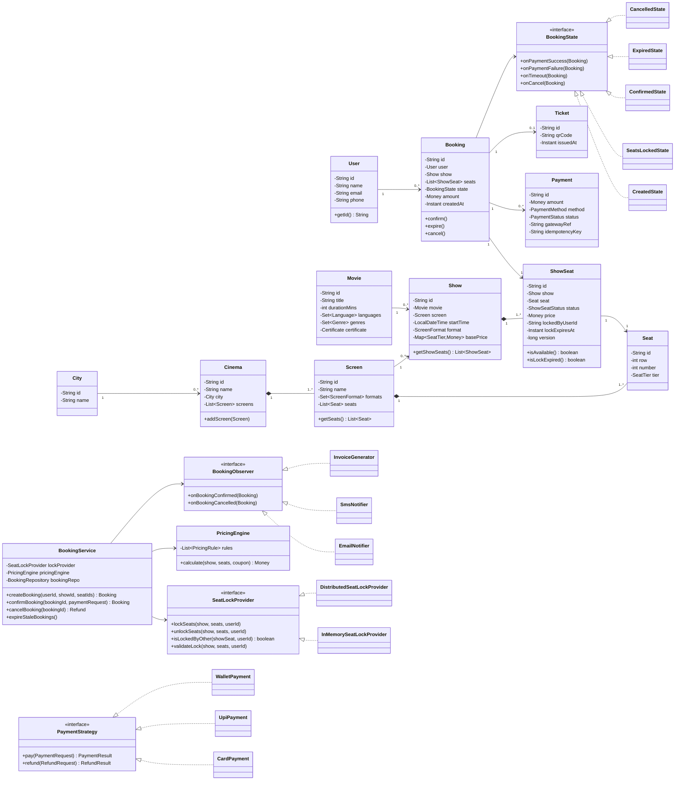
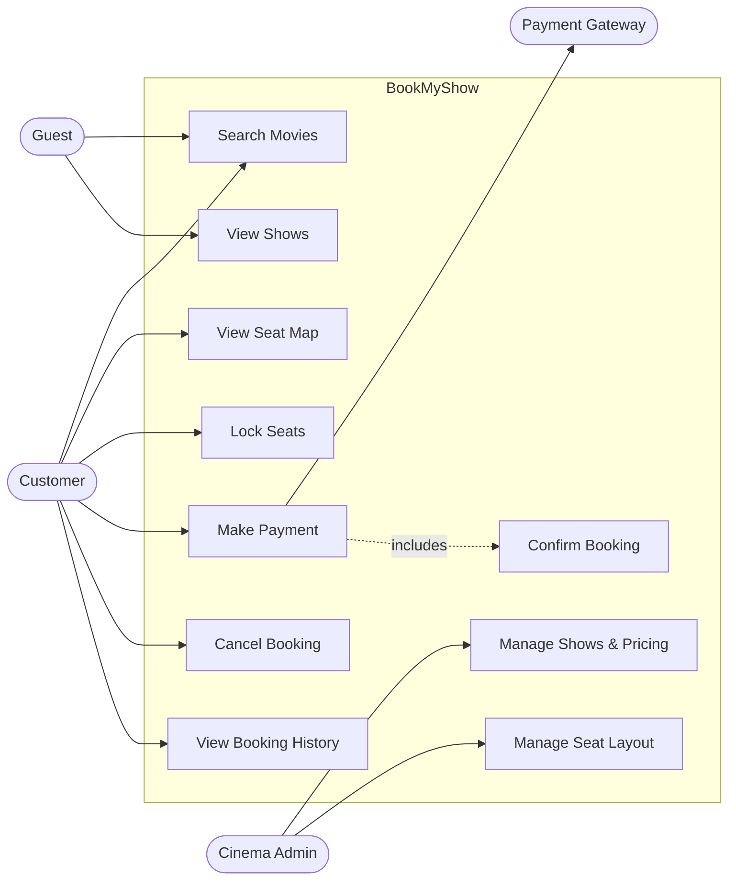
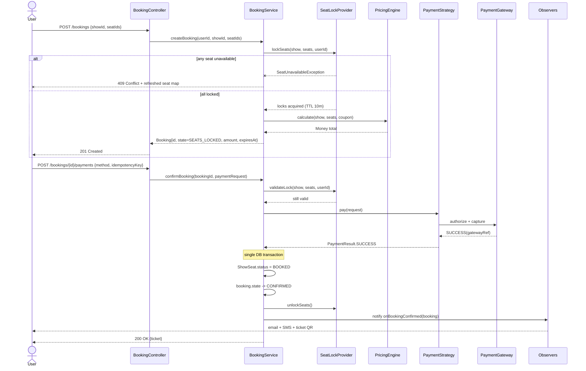
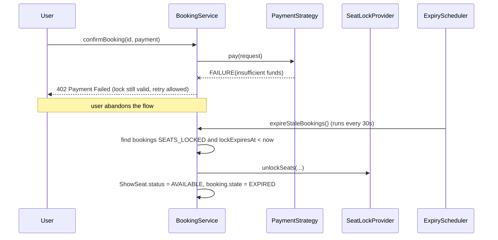
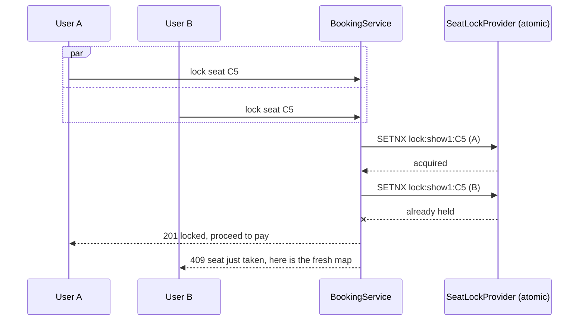
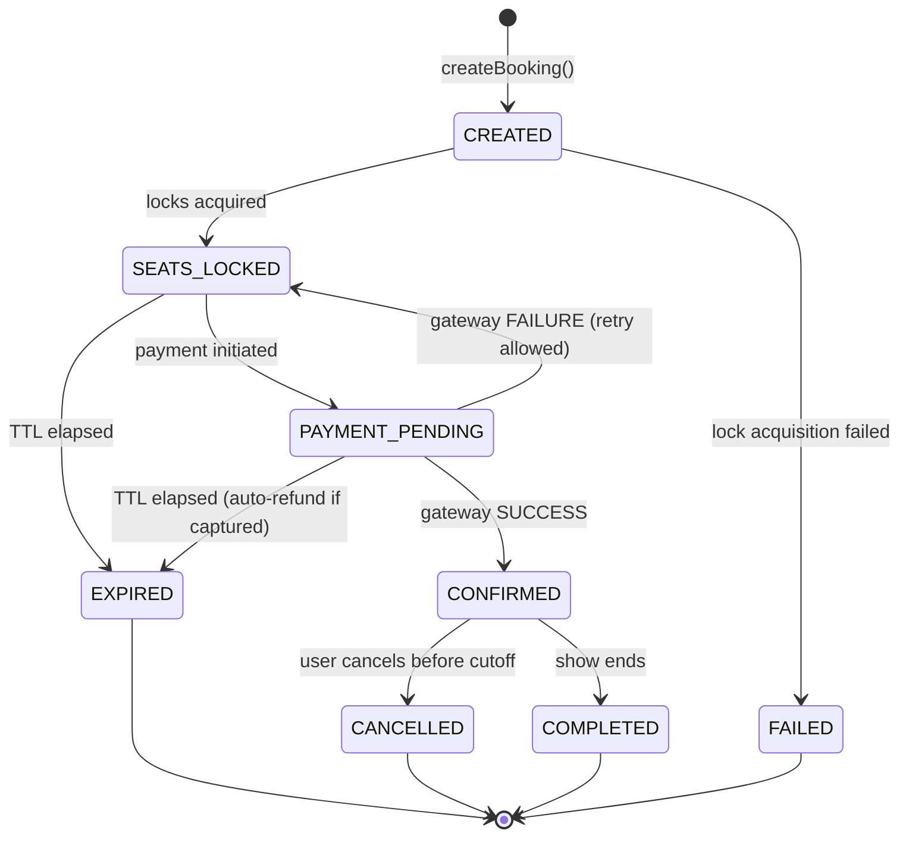

# Low Level Design — BookMyShow (Movie Ticket Booking System)

A complete LLD walkthrough: requirement gathering, UML, class design, pseudocode, concurrency
handling, design patterns, and the interview questions that usually come with it.

---

## Table of Contents

1. [Problem Statement](#1-problem-statement)
2. [Requirement Gathering](#2-requirement-gathering)
3. [Clarifying Questions to Ask the Interviewer](#3-clarifying-questions-to-ask-the-interviewer)
4. [Core Objects & Entities](#4-core-objects--entities)
5. [UML — Class Diagram](#5-uml--class-diagram)
6. [UML — Use Case Diagram](#6-uml--use-case-diagram)
7. [UML — Sequence Diagrams](#7-uml--sequence-diagrams)
8. [UML — Booking State Machine](#8-uml--booking-state-machine)
9. [Design Patterns Used](#9-design-patterns-used)
10. [Pseudocode / Skeleton Implementation](#10-pseudocode--skeleton-implementation)
11. [The Hard Part: Concurrent Seat Booking](#11-the-hard-part-concurrent-seat-booking)
12. [Pricing Engine](#12-pricing-engine)
13. [Database Schema](#13-database-schema)
14. [API Design](#14-api-design)
15. [Non-Functional Concerns](#15-non-functional-concerns)
16. [Interview Questions & Answers](#16-interview-questions--answers)
17. [Extensions & Follow-ups](#17-extensions--follow-ups)
18. [Project Structure](#18-project-structure)

---

## 1. Problem Statement

Design a movie ticket booking platform where a user can:

- browse movies playing in their city,
- pick a cinema, a show and specific seats,
- hold those seats while they pay,
- pay and receive a ticket,
- cancel and get refunded under policy.

The system must guarantee that **no two users ever book the same seat for the same show**, even
under heavy contention (think opening-night blockbuster).

Scope boundary for a 45–60 minute LLD round: single-region, relational store, in-process service
objects. Distributed concerns are discussed but not built.

---

## 2. Requirement Gathering

### 2.1 Actors

| Actor | Responsibility |
|---|---|
| Guest | Browse movies/shows without login |
| Customer | Book, pay, cancel, view bookings |
| Cinema Admin | Manage screens, shows, seat layout, pricing |
| System Admin | Manage movies, cities, cinemas, coupons |
| Payment Gateway | External; authorizes/captures/refunds |
| Notification Service | External; email / SMS / push |

### 2.2 Functional Requirements (in scope)

- **FR1** Search movies by city, title, language, genre, format (2D/3D/IMAX), date.
- **FR2** List cinemas and shows for a selected movie + city + date.
- **FR3** View live seat map for a show with status: `AVAILABLE | LOCKED | BOOKED`.
- **FR4** Select 1..N seats and **temporarily lock** them (default TTL 10 minutes).
- **FR5** Compute price: base seat price + format surcharge + weekend/peak multiplier + coupon − discount + convenience fee + GST.
- **FR6** Pay via multiple methods (card, UPI, netbanking, wallet). Retry on failure within lock TTL.
- **FR7** On payment success → confirm booking, generate ticket, notify user.
- **FR8** On payment failure / timeout → release seats automatically.
- **FR9** Cancel booking; refund per policy (e.g. 100% > 24h, 50% 2–24h, 0% < 2h before showtime).
- **FR10** View booking history and download/reprint ticket.
- **FR11** Admin: CRUD on movie, cinema, screen, seat layout, show, price tier, coupon.

### 2.3 Out of Scope (state this explicitly)

Recommendations, reviews/ratings, food & beverage add-ons, loyalty points, gift cards,
dynamic surge pricing by ML, live events/sports, multi-city cart.

### 2.4 Non-Functional Requirements

| NFR | Target |
|---|---|
| Consistency | **Strong** for seat inventory (no double booking, ever) |
| Availability | Read path (browse/search) highly available, eventual consistency OK |
| Latency | Search < 300 ms p99; seat-map load < 200 ms; lock acquisition < 100 ms |
| Scale | ~10M DAU, read:write ≈ 100:1, spiky traffic on releases |
| Durability | Bookings and payments must never be lost |
| Idempotency | Payment callbacks and booking creation must be idempotent |
| Auditability | Every state change on a booking is recorded |

### 2.5 Key Assumptions

- A seat belongs to exactly one screen; a `ShowSeat` is the per-show instance of that seat.
- Seat locks are **soft holds** with a TTL, not DB row locks held across a user session.
- Payment gateway is asynchronous and may call back more than once.
- Prices are set per show per seat-tier by the cinema admin.

---

## 3. Clarifying Questions to Ask the Interviewer

Asking these early is half the score in an LLD round.

1. Is this read-heavy browse flow in scope, or only the booking/seat-locking core?
2. Must seat selection be explicit, or can the system auto-allocate best available seats?
3. How long do we hold seats during payment? Is the hold renewable?
4. Can one booking span multiple shows or only one? (Assume one.)
5. Max seats per booking? (Assume 10.)
6. Do we support partial cancellation (cancel 2 of 5 seats)? (Assume no, v1.)
7. Single payment method per booking, or split payment? (Assume single.)
8. Do we need seat-adjacency rules / no-single-seat-gap enforcement?
9. Are we designing in-memory for the interview, or with a real DB and transactions?
10. Single instance or multiple app servers? (Changes locking from `ReentrantLock` to Redis/DB.)

---

## 4. Core Objects & Entities

Noun extraction from the requirements, then filtered down to real entities:

**Identity & Location**: `User`, `Account`, `City`, `Address`
**Catalog**: `Movie`, `Genre`, `Language`, `ScreenFormat`
**Venue**: `Cinema`, `Screen`, `Seat`, `SeatTier`
**Scheduling**: `Show`, `ShowSeat`
**Transaction**: `Booking`, `BookingState`, `Payment`, `Ticket`, `Coupon`, `Refund`
**Infrastructure services**: `SeatLockProvider`, `PricingEngine`, `PaymentStrategy`,
`NotificationObserver`, `*Repository`

### Entity Responsibilities

| Class | Responsibility | Key fields |
|---|---|---|
| `User` | Identity of a customer | `id, name, email, phone, cityId` |
| `Movie` | Immutable catalog item | `id, title, durationMins, languages, genres, formats, certificate` |
| `Cinema` | A multiplex in a city | `id, name, cityId, address, screens[]` |
| `Screen` | One audi inside a cinema | `id, cinemaId, name, supportedFormats, seats[]` |
| `Seat` | Physical seat, static | `id, screenId, row, number, tier` |
| `SeatTier` | Pricing class | `SILVER, GOLD, PLATINUM, RECLINER` |
| `Show` | Movie × Screen × StartTime | `id, movieId, screenId, startTime, endTime, format, language, basePriceByTier` |
| `ShowSeat` | Seat state for one show | `id, showId, seatId, status, price, lockedBy, lockExpiresAt, version` |
| `Booking` | The aggregate root of a transaction | `id, userId, showId, showSeatIds[], state, amount, createdAt` |
| `Payment` | One attempt at paying | `id, bookingId, amount, method, status, gatewayRef, idempotencyKey` |
| `Ticket` | Issued artifact | `id, bookingId, qrCode, issuedAt` |
| `Coupon` | Discount rule | `code, type, value, maxDiscount, validTill, usageLimit` |

**Design note:** `Booking` is the aggregate root. Nothing outside the booking aggregate mutates
`ShowSeat.status` directly — all transitions go through `BookingService` / `SeatLockProvider`.

---

## 5. UML — Class Diagram



### ASCII fallback (for terminals / non-Mermaid renderers)

```
                    +----------+        +-----------+
                    |   City   |1----*  |  Cinema   |
                    +----------+        +-----------+
                                              |1
                                              | composition
                                              *
+---------+                             +-----------+        +--------+
|  Movie  |1                         1  |  Screen   |1----*  |  Seat  |
+---------+ \                          /+-----------+        +--------+
             \                        /                           ^
              *                      *                            |
             +------------------------+                           |
             |         Show           |1-------------* +--------------+
             +------------------------+                | ShowSeat     |
                                                       | status       |
                                                       | price        |
+--------+          +------------+                     | lockedBy     |
|  User  |1-------* |  Booking   |1-----------------*  | lockExpires  |
+--------+          +------------+                     | version      |
                      |  |    |                        +--------------+
                      |  |    +---1 Ticket
                      |  +--------* Payment --> PaymentStrategy
                      +-----------> BookingState (State pattern)
```

---

## 6. UML — Use Case Diagram



---

## 7. UML — Sequence Diagrams

### 7.1 Happy path: select seats → pay → ticket



### 7.2 Failure path: payment fails / lock expires



### 7.3 Two users racing for the same seat



---

## 8. UML — Booking State Machine



**Invariants**
- A `ShowSeat` is `BOOKED` only if exactly one `CONFIRMED` booking references it.
- `EXPIRED`, `CANCELLED`, `COMPLETED`, `FAILED` are terminal.
- Any transition out of `SEATS_LOCKED` must release the lock.

---

## 9. Design Patterns Used

| # | Pattern | Where | Why |
|---|---|---|---|
| 1 | **Strategy** | `PaymentStrategy`, `SeatAllocationStrategy`, `RefundPolicy` | Swap algorithms at runtime without touching `BookingService` |
| 2 | **State** | `BookingState` hierarchy | Booking behaviour differs per state; kills a giant `switch` and prevents illegal transitions |
| 3 | **Observer** | `BookingObserver` → email, SMS, invoice, analytics | Decouple "booking confirmed" from its side effects; add channels without edits |
| 4 | **Factory Method / Abstract Factory** | `PaymentStrategyFactory`, `NotificationFactory` | Centralise object creation by enum/config |
| 5 | **Singleton** | `SeatLockProvider`, config registry | One authoritative lock table per process (use DI-scoped singleton, not static) |
| 6 | **Decorator / Chain** | `PricingRule` chain: base → format → peak → coupon → fee → tax | Compose price adjustments in order, each independently testable |
| 7 | **Builder** | `Booking.Builder`, `Show.Builder` | Many optional fields; immutable objects |
| 8 | **Facade** | `BookingFacade` / `BookingService` | One entry point hiding lock + price + payment + notify orchestration |
| 9 | **Repository (DAO)** | `ShowRepository`, `BookingRepository` | Isolate persistence; allows in-memory impl for the interview |
| 10 | **Chain of Responsibility** | Validation pipeline: auth → max-seats → seat-adjacency → show-not-started → lock | Each rule is a link; order matters; easy to insert new rules |
| 11 | **Command** | `CancelBookingCommand`, `RefundCommand` | Queue, audit, retry and undo operations |
| 12 | **Template Method** | `AbstractPaymentStrategy.pay()` → `validate() / execute() / postProcess()` | Fix the skeleton, vary the steps |
| 13 | **Flyweight** (optional) | `Seat` metadata shared across shows | Thousands of `ShowSeat` rows reuse static seat attributes |
| 14 | **Proxy** | `CachedShowRepository` | Transparent Redis cache in front of seat-map reads |

### Patterns deliberately *not* used
- No **Visitor** — the entity hierarchy is stable and shallow.
- No **Prototype** — cloning bookings is meaningless here.
- Mentioning a pattern you don't need is a minus in interviews. Justify every one.

### SOLID mapping
- **S**: `PricingEngine` prices, `SeatLockProvider` locks, `BookingService` orchestrates. No class does two of these.
- **O**: new payment method = new `PaymentStrategy` class, zero edits elsewhere.
- **L**: every `PaymentStrategy` honours the same contract (returns a result; never throws for a declined card).
- **I**: `SeatLockProvider` is narrow; readers depend on `ShowSeatReader`, not the write interface.
- **D**: `BookingService` depends on the `SeatLockProvider` interface, injected — in-memory in tests, Redis in prod.

---

## 10. Pseudocode / Skeleton Implementation

### 10.1 Enums and value objects

```java
enum SeatTier { SILVER, GOLD, PLATINUM, RECLINER }
enum ScreenFormat { TWO_D, THREE_D, IMAX, FOUR_DX }
enum ShowSeatStatus { AVAILABLE, LOCKED, BOOKED }
enum BookingStatus { CREATED, SEATS_LOCKED, PAYMENT_PENDING, CONFIRMED,
                     EXPIRED, CANCELLED, COMPLETED, FAILED }
enum PaymentMethod { CARD, UPI, NETBANKING, WALLET }
enum PaymentStatus { INITIATED, SUCCESS, FAILED, REFUNDED }

final class Money {                     // immutable value object
    BigDecimal amount
    Currency currency
    Money plus(Money o)   { assertSameCurrency(o); return new Money(amount.add(o.amount), currency) }
    Money times(double f) { return new Money(amount.multiply(f), currency) }
}
```

### 10.2 ShowSeat — the contended resource

```java
class ShowSeat {
    String id
    Show show
    Seat seat
    ShowSeatStatus status = AVAILABLE
    Money price
    String lockedByUserId
    Instant lockExpiresAt
    long version                        // optimistic locking

    boolean isLockExpired() {
        return lockExpiresAt != null AND Instant.now().isAfter(lockExpiresAt)
    }

    boolean isBookable(String userId) {
        if (status == BOOKED) return false
        if (status == LOCKED) {
            return isLockExpired() OR lockedByUserId.equals(userId)
        }
        return true                     // AVAILABLE
    }
}
```

### 10.3 SeatLockProvider — single-node version

```java
interface SeatLockProvider {
    void lockSeats(Show show, List<ShowSeat> seats, String userId)   // throws SeatUnavailableException
    void unlockSeats(Show show, List<ShowSeat> seats, String userId)
    void validateLock(Show show, List<ShowSeat> seats, String userId)
}

class InMemorySeatLockProvider implements SeatLockProvider {

    final Duration ttl                                   // e.g. 10 minutes
    final Map<String, Lock> showLocks = new ConcurrentHashMap<>()   // one lock per SHOW, not global

    void lockSeats(show, seats, userId) {
        Lock lock = showLocks.computeIfAbsent(show.id, k -> new ReentrantLock())
        lock.lock()                                      // critical section scoped to one show
        try {
            // 1. check-all before mutate-any  → all-or-nothing
            for (ShowSeat s : seats) {
                if (!s.isBookable(userId))
                    throw new SeatUnavailableException(s.seat.label())
            }
            // 2. commit
            Instant expiry = Instant.now().plus(ttl)
            for (ShowSeat s : seats) {
                s.status = LOCKED
                s.lockedByUserId = userId
                s.lockExpiresAt = expiry
            }
        } finally {
            lock.unlock()
        }
    }

    void validateLock(show, seats, userId) {
        for (ShowSeat s : seats) {
            if (s.status != LOCKED
                || !userId.equals(s.lockedByUserId)
                || s.isLockExpired())
                throw new LockExpiredException(s.id)
        }
    }

    void unlockSeats(show, seats, userId) {
        Lock lock = showLocks.get(show.id); lock.lock()
        try {
            for (ShowSeat s : seats) {
                if (s.status == LOCKED AND userId.equals(s.lockedByUserId)) {
                    s.status = AVAILABLE
                    s.lockedByUserId = null
                    s.lockExpiresAt = null
                }
            }
        } finally { lock.unlock() }
    }
}
```

> **Why lock per show and not globally?** A global `synchronized` serialises every booking in the
> country. Per-show striping keeps contention confined to the seats that actually conflict.

### 10.4 Distributed version (multi-server)

```java
class DistributedSeatLockProvider implements SeatLockProvider {
    RedisClient redis
    Duration ttl

    void lockSeats(show, seats, userId) {
        List<String> acquired = []
        try {
            for (ShowSeat s : seats) {
                String key = "lock:show:" + show.id + ":seat:" + s.id
                // atomic set-if-absent with expiry; TTL is the self-healing part
                boolean ok = redis.set(key, userId, NX, EX = ttl.seconds)
                if (!ok) throw new SeatUnavailableException(s.seat.label())
                acquired.add(key)
            }
        } catch (SeatUnavailableException e) {
            for (String k : acquired) releaseIfOwner(k, userId)   // compensate: no partial locks
            throw e
        }
    }

    void releaseIfOwner(String key, String userId) {
        // Lua so that GET-compare-DEL is atomic; prevents deleting someone else's lock
        redis.eval("if redis.call('get',KEYS[1])==ARGV[1] then return redis.call('del',KEYS[1]) else return 0 end",
                   keys=[key], args=[userId])
    }
}
```

### 10.5 BookingService — the facade/orchestrator

```java
class BookingService {

    SeatLockProvider lockProvider
    PricingEngine pricingEngine
    PaymentStrategyFactory paymentFactory
    ShowRepository showRepo
    BookingRepository bookingRepo
    List<BookingObserver> observers
    List<BookingValidator> validators          // chain of responsibility
    int MAX_SEATS_PER_BOOKING = 10

    Booking createBooking(String userId, String showId, List<String> seatIds, String couponCode) {
        Show show = showRepo.findById(showId).orElseThrow(ShowNotFoundException::new)

        if (show.startTime.isBefore(now()))      throw new ShowAlreadyStartedException()
        if (seatIds.isEmpty())                   throw new NoSeatsSelectedException()
        if (seatIds.size() > MAX_SEATS_PER_BOOKING) throw new TooManySeatsException()

        List<ShowSeat> seats = show.resolveSeats(seatIds)

        for (BookingValidator v : validators) v.validate(userId, show, seats)

        lockProvider.lockSeats(show, seats, userId)          // may throw SeatUnavailable

        try {
            Money amount = pricingEngine.calculate(show, seats, couponCode)
            Booking booking = Booking.builder()
                    .id(idGen.next())
                    .userId(userId).show(show).seats(seats)
                    .amount(amount)
                    .state(new SeatsLockedState())
                    .expiresAt(now().plus(LOCK_TTL))
                    .build()
            return bookingRepo.save(booking)
        } catch (Exception e) {
            lockProvider.unlockSeats(show, seats, userId)     // never leak a lock
            throw e
        }
    }

    @Transactional
    Booking confirmBooking(String bookingId, PaymentRequest req) {
        Booking b = bookingRepo.findByIdForUpdate(bookingId)   // SELECT ... FOR UPDATE

        if (b.state is ConfirmedState) return b                // IDEMPOTENT replay
        if (b.state is ExpiredState)   throw new BookingExpiredException()

        lockProvider.validateLock(b.show, b.seats, b.userId)

        PaymentStrategy strategy = paymentFactory.create(req.method)
        PaymentResult result = strategy.pay(req.withIdempotencyKey(b.id))

        if (!result.isSuccess()) {
            b.recordFailedPayment(result)
            bookingRepo.save(b)
            throw new PaymentFailedException(result.reason)     // lock still alive; retry allowed
        }

        for (ShowSeat s : b.seats) {
            s.status = BOOKED                                   // version check fires here
            s.lockedByUserId = null; s.lockExpiresAt = null
        }
        b.state.onPaymentSuccess(b)                             // -> ConfirmedState, issues Ticket
        bookingRepo.save(b)
        lockProvider.unlockSeats(b.show, b.seats, b.userId)

        // after commit, so observers never see an uncommitted booking
        afterCommit(() -> observers.forEach(o -> o.onBookingConfirmed(b)))
        return b
    }

    Refund cancelBooking(String bookingId, String userId) {
        Booking b = bookingRepo.findByIdForUpdate(bookingId)
        if (!b.userId.equals(userId)) throw new ForbiddenException()

        RefundPolicy policy = refundPolicyResolver.resolve(b.show.startTime)
        Money refundAmount = policy.computeRefund(b.amount, now(), b.show.startTime)

        for (ShowSeat s : b.seats) s.status = AVAILABLE          // inventory back
        b.state.onCancel(b)

        Refund r = paymentFactory.create(b.lastPayment().method)
                                .refund(new RefundRequest(b, refundAmount))
        bookingRepo.save(b)
        afterCommit(() -> observers.forEach(o -> o.onBookingCancelled(b)))
        return r
    }

    @Scheduled(every = "30s")
    void expireStaleBookings() {
        for (Booking b : bookingRepo.findExpirable(now())) {     // SEATS_LOCKED/PENDING && expiresAt<now
            lockProvider.unlockSeats(b.show, b.seats, b.userId)
            for (ShowSeat s : b.seats) if (s.status == LOCKED) s.status = AVAILABLE
            b.state.onTimeout(b)
            bookingRepo.save(b)
        }
    }
}
```

### 10.6 State pattern

```java
interface BookingState {
    void onPaymentSuccess(Booking b)
    void onPaymentFailure(Booking b)
    void onTimeout(Booking b)
    void onCancel(Booking b)
}

abstract class AbstractBookingState implements BookingState {
    // default: reject the transition instead of silently ignoring it
    void onPaymentSuccess(Booking b) { throw new IllegalStateTransition(this, "paymentSuccess") }
    void onPaymentFailure(Booking b) { throw new IllegalStateTransition(this, "paymentFailure") }
    void onTimeout(Booking b)        { throw new IllegalStateTransition(this, "timeout") }
    void onCancel(Booking b)         { throw new IllegalStateTransition(this, "cancel") }
}

class SeatsLockedState extends AbstractBookingState {
    void onPaymentSuccess(Booking b) {
        b.ticket = Ticket.issueFor(b)
        b.status = CONFIRMED
        b.state  = new ConfirmedState()
    }
    void onPaymentFailure(Booking b) { /* stay here, allow retry until TTL */ }
    void onTimeout(Booking b) { b.status = EXPIRED;   b.state = new ExpiredState() }
    void onCancel(Booking b)  { b.status = CANCELLED; b.state = new CancelledState() }
}

class ConfirmedState extends AbstractBookingState {
    void onPaymentSuccess(Booking b) { /* no-op: idempotent duplicate callback */ }
    void onCancel(Booking b) {
        if (b.show.startTime.minusHours(2).isBefore(now()))
            throw new CancellationWindowClosedException()
        b.status = CANCELLED; b.state = new CancelledState()
    }
}

class ExpiredState extends AbstractBookingState {}      // terminal, rejects everything
class CancelledState extends AbstractBookingState {}
```

### 10.7 Strategy + Template Method for payments

```java
abstract class AbstractPaymentStrategy implements PaymentStrategy {
    final PaymentResult pay(PaymentRequest req) {        // template method, final
        validate(req)
        PaymentResult r = execute(req)
        audit(req, r)
        return r
    }
    abstract PaymentResult execute(PaymentRequest req)
    void validate(PaymentRequest req) { if (req.amount.isNonPositive()) throw new InvalidAmountException() }
    void audit(req, r) { auditLog.write(req.bookingId, r.status, r.gatewayRef) }
}

class UpiPayment extends AbstractPaymentStrategy {
    PaymentResult execute(req) {
        GatewayResponse resp = upiGateway.collect(req.vpa, req.amount, req.idempotencyKey)
        return resp.isOk() ? PaymentResult.success(resp.ref)
                           : PaymentResult.failure(resp.errorCode)
    }
}

class PaymentStrategyFactory {
    PaymentStrategy create(PaymentMethod m) {
        switch (m) {
            case CARD:    return new CardPayment(cardGateway)
            case UPI:     return new UpiPayment(upiGateway)
            case WALLET:  return new WalletPayment(walletClient)
            default:      throw new UnsupportedPaymentMethodException(m)
        }
    }
}
```

### 10.8 Observer

```java
interface BookingObserver {
    void onBookingConfirmed(Booking b)
    void onBookingCancelled(Booking b)
}

class EmailNotifier implements BookingObserver {
    void onBookingConfirmed(Booking b) {
        emailClient.send(b.user.email, Templates.TICKET, b.ticket.qrCode)
    }
}
class SmsNotifier     implements BookingObserver { ... }
class AnalyticsSink   implements BookingObserver { ... }

// Registration — typically via DI
bookingService.register(new EmailNotifier())
bookingService.register(new SmsNotifier())
```

> In production, publish a `BookingConfirmedEvent` to Kafka and let consumers do this, so a dead
> SMS provider can't fail a paid booking. The Observer interface is the in-process stand-in.

### 10.9 Seat allocation strategy (auto-pick)

```java
interface SeatAllocationStrategy {
    List<ShowSeat> allocate(Show show, int count, SeatTier preferredTier)
}

class BestAvailableStrategy implements SeatAllocationStrategy {
    // prefer contiguous seats, centre of the row, in the requested tier
    List<ShowSeat> allocate(show, count, tier) {
        for (Row row : show.rowsByPreference(tier)) {
            List<ShowSeat> window = row.findContiguousAvailable(count)
            if (window != null) return window
        }
        throw new NoContiguousSeatsException()
    }
}
class CheapestFirstStrategy implements SeatAllocationStrategy { ... }
```

---

## 11. The Hard Part: Concurrent Seat Booking

This is what the round is really testing. Layer the defences:

### Layer 1 — Application lock (soft hold, user-facing)
Redis `SET key value NX EX 600`. Gives the user a 10-minute window to pay, survives app crashes
via TTL, and keeps the seat map honest for everyone else. **Not** a correctness guarantee on its
own — Redis is not the source of truth.

### Layer 2 — Database guarantee (hard, correctness)

Pick one and be able to defend it:

**(a) Pessimistic locking**
```sql
BEGIN;
SELECT * FROM show_seat
 WHERE show_id = :s AND seat_id IN (:ids)
   FOR UPDATE;                      -- blocks competing txns
-- verify all AVAILABLE, then:
UPDATE show_seat SET status='BOOKED' WHERE id IN (:ids);
COMMIT;
```
Simple and airtight. Cost: writers queue up; must keep the txn short (never hold across a payment call).

**(b) Optimistic locking**
```sql
UPDATE show_seat
   SET status = 'BOOKED', version = version + 1
 WHERE id = :id AND status = 'AVAILABLE' AND version = :v;
-- affectedRows == 0  =>  someone beat us, abort + retry/refresh
```
Better throughput, no blocking; caller must handle conflict. Good when conflicts are rare.

**(c) Unique constraint as the last line of defence**
```sql
CREATE TABLE booked_seat (
  show_id   BIGINT NOT NULL,
  seat_id   BIGINT NOT NULL,
  booking_id BIGINT NOT NULL,
  UNIQUE (show_id, seat_id)        -- the DB physically cannot double book
);
```
Even if every layer above has a bug, the insert fails. Cheap insurance; always add it.

### Layer 3 — Idempotency
`Payment.idempotencyKey = bookingId` and a unique index on it. Gateway retries and duplicate
webhooks then cannot charge twice or create a second confirmed booking.

### Layer 4 — Reaper job
A scheduled sweep (`expireStaleBookings`) releases seats whose lock expired but whose booking was
never terminated — covers app crashes between lock and confirm.

### Deadlock avoidance
When locking multiple seats, **always acquire in a deterministic order** (sort by `seat_id`).
Two users picking seats {C4, C5} and {C5, C4} otherwise deadlock.

### Failure scenarios checklist

| Scenario | Handling |
|---|---|
| App crashes after lock, before payment | Redis TTL expires → seat free; reaper cleans booking row |
| Payment succeeds, app crashes before confirm | Gateway webhook is idempotent → replay confirms booking; reconciliation job matches captures to bookings |
| Payment fails | Keep lock, let user retry until TTL |
| Duplicate webhook | `ConfirmedState.onPaymentSuccess` is a no-op |
| Money captured but seats gone (lock expired) | Auto-refund, notify user, log for ops |
| Redis down | Fall back to DB pessimistic locking (degraded latency, still correct) |

---

## 12. Pricing Engine

A chain of composable rules, applied in a fixed order:

```java
interface PricingRule { Money apply(PricingContext ctx, Money running) }

class BaseTierPriceRule     implements PricingRule {}   // basePrice[tier] * seatCount
class FormatSurchargeRule   implements PricingRule {}   // IMAX +40%, 3D +20%
class PeakTimeRule          implements PricingRule {}   // Fri-Sun & 18:00-23:00 → +15%
class CouponDiscountRule    implements PricingRule {}   // percent/flat, capped at maxDiscount
class ConvenienceFeeRule    implements PricingRule {}   // flat per ticket
class TaxRule               implements PricingRule {}   // GST on (base + fee), applied last

class PricingEngine {
    List<PricingRule> orderedRules
    Money calculate(Show show, List<ShowSeat> seats, String couponCode) {
        PricingContext ctx = new PricingContext(show, seats, couponResolver.find(couponCode))
        Money running = Money.zero(INR)
        for (PricingRule r : orderedRules) running = r.apply(ctx, running)
        return running
    }
}
```

Worked example — 2 PLATINUM seats, IMAX, Saturday 8pm, coupon `FIRST50` (50% off, cap ₹150):

```
base         2 × 400                = 800
IMAX         +40%                   = 1120
peak         +15%                   = 1288
coupon       min(644, 150)          = 1138
conv. fee    2 × 30                 = 1198
GST          18% of 1198            = 1413.64
```

Keep money in `BigDecimal` or integer paise. Never `double`.

---

## 13. Database Schema

```sql
CREATE TABLE city (id BIGINT PK, name VARCHAR(80), state VARCHAR(80));

CREATE TABLE movie (
  id BIGINT PK, title VARCHAR(200), duration_mins INT,
  certificate VARCHAR(10), release_date DATE,
  INDEX idx_title (title)
);

CREATE TABLE cinema (
  id BIGINT PK, name VARCHAR(150), city_id BIGINT FK,
  address TEXT, INDEX idx_city (city_id)
);

CREATE TABLE screen (
  id BIGINT PK, cinema_id BIGINT FK, name VARCHAR(50),
  total_seats INT, supported_formats VARCHAR(100)
);

CREATE TABLE seat (
  id BIGINT PK, screen_id BIGINT FK,
  row_label VARCHAR(5), seat_number INT, tier VARCHAR(20),
  UNIQUE (screen_id, row_label, seat_number)
);

CREATE TABLE show (
  id BIGINT PK, movie_id BIGINT FK, screen_id BIGINT FK,
  start_time DATETIME, end_time DATETIME,
  format VARCHAR(20), language VARCHAR(30),
  INDEX idx_lookup (movie_id, start_time),
  INDEX idx_screen_time (screen_id, start_time)   -- detect overlapping shows
);

CREATE TABLE show_seat (
  id BIGINT PK, show_id BIGINT FK, seat_id BIGINT FK,
  status ENUM('AVAILABLE','LOCKED','BOOKED') DEFAULT 'AVAILABLE',
  price DECIMAL(10,2),
  locked_by_user_id BIGINT NULL,
  lock_expires_at DATETIME NULL,
  version BIGINT DEFAULT 0,
  UNIQUE (show_id, seat_id),                      -- one row per seat per show
  INDEX idx_show_status (show_id, status),
  INDEX idx_lock_expiry (lock_expires_at)         -- for the reaper
);

CREATE TABLE booking (
  id BIGINT PK, user_id BIGINT FK, show_id BIGINT FK,
  status VARCHAR(25), amount DECIMAL(10,2),
  created_at DATETIME, expires_at DATETIME,
  INDEX idx_user (user_id, created_at),
  INDEX idx_expiry (status, expires_at)
);

CREATE TABLE booking_seat (
  booking_id BIGINT FK, show_seat_id BIGINT FK,
  PRIMARY KEY (booking_id, show_seat_id),
  UNIQUE (show_seat_id)      -- a show_seat can belong to at most ONE booking: hard guard
);

CREATE TABLE payment (
  id BIGINT PK, booking_id BIGINT FK, amount DECIMAL(10,2),
  method VARCHAR(20), status VARCHAR(20),
  gateway_ref VARCHAR(100), idempotency_key VARCHAR(100),
  created_at DATETIME,
  UNIQUE (idempotency_key)
);

CREATE TABLE ticket (
  id BIGINT PK, booking_id BIGINT FK UNIQUE,
  qr_code VARCHAR(255), issued_at DATETIME
);
```

**Why pre-materialise `show_seat` rows?** Creating one row per seat at show-creation time makes
the seat map a single indexed read and gives every seat a lockable identity. The alternative
(deriving availability by joining bookings) makes the hot read path expensive.

---

## 14. API Design

```
GET  /v1/cities
GET  /v1/movies?cityId=&date=&language=&genre=&format=
GET  /v1/movies/{movieId}/shows?cityId=&date=
GET  /v1/shows/{showId}/seats                → seat map with live status

POST /v1/bookings
     { showId, seatIds[], couponCode? }
     201 → { bookingId, amount, breakdown, state:"SEATS_LOCKED", expiresAt }
     409 → { error:"SEATS_UNAVAILABLE", unavailableSeats:["C5"], seatMap:{...} }

POST /v1/bookings/{id}/payments
     Idempotency-Key: <uuid>
     { method, paymentDetails }
     200 → { bookingId, state:"CONFIRMED", ticket:{ id, qrCode } }
     402 → { error:"PAYMENT_FAILED", reason, retryAllowedUntil }
     410 → { error:"BOOKING_EXPIRED" }

POST /v1/bookings/{id}/cancel     → { refundAmount, refundStatus }
GET  /v1/users/{id}/bookings?status=
POST /v1/webhooks/payments        (gateway → us; idempotent)

Admin:
POST /v1/admin/cinemas, /screens, /screens/{id}/seats, /shows, /coupons
```

Return the refreshed seat map on `409` so the client can re-render without a second round trip.

---

## 15. Non-Functional Concerns

- **Caching**: movie/cinema/show metadata in Redis (TTL minutes). Never cache seat status for
  long — short TTL (1–2 s) or push updates over WebSocket.
- **Read/write split**: search and browse hit read replicas; booking writes go to primary.
- **Sharding**: shard `show_seat` and `booking` by `show_id` (or city). All contention for a seat
  stays inside one shard, so a single-shard transaction is enough.
- **Hot shows**: queue/waiting-room pattern for blockbuster on-sale moments; virtual queue tokens.
- **Observability**: metrics on lock contention rate, lock-expiry rate, payment success rate,
  409-conflict rate, time-to-confirm.
- **Rate limiting**: per-user lock attempts to stop seat-hoarding bots; CAPTCHA on high demand.
- **Testing**: concurrency tests with `CountDownLatch` firing N threads at the same seat and
  asserting exactly one success.

---

## 16. Interview Questions & Answers

### Design & modelling

**Q1. Why separate `Seat` and `ShowSeat`?**
`Seat` is physical and immutable (row C, number 5, platinum). `ShowSeat` is its state for one
particular show (available/booked, price, lock holder). Merging them would mean mutating shared
physical data per show, which breaks as soon as two shows run in the same screen.

**Q2. What's your aggregate root and why does it matter?**
`Booking`. All seat-status mutations happen inside a booking transaction via `BookingService`.
Nothing else is allowed to set `ShowSeat.status`. That single rule is what makes the double-booking
invariant enforceable in one place.

**Q3. Where would inheritance be wrong here?**
`class PremiumSeat extends Seat` — tier is data, not behaviour; subclassing it explodes the
hierarchy and breaks on tier changes. Use a `SeatTier` enum plus pricing rules.

**Q4. Why not put `calculatePrice()` on `Show`?**
Pricing depends on coupons, taxes, user segment, and time — none of which are `Show`'s concern.
That would violate SRP and make `Show` depend on the coupon service. Extract `PricingEngine`.

### Concurrency

**Q5. Two users click seat C5 at the exact same millisecond. Walk me through it.**
Both hit `createBooking`. The lock provider performs an atomic check-and-set — `ReentrantLock`
keyed by show in a single process, or Redis `SET NX EX` per seat across servers. One acquires;
the other gets `SeatUnavailableException` → HTTP 409 with a refreshed map. At confirm time, the DB
`SELECT ... FOR UPDATE` (or an optimistic `UPDATE ... WHERE status='AVAILABLE'`) re-verifies, and a
`UNIQUE (show_id, seat_id)` constraint on `booked_seat` is the final backstop.

**Q6. Why not just hold a DB transaction open during payment?**
Payment takes seconds to minutes and involves a third party. Holding row locks that long starves
other users, exhausts the connection pool, and risks a hung transaction leaving seats locked
forever. Hence a short-lived app-level soft lock with TTL, and a short DB transaction only at
confirm.

**Q7. Pessimistic vs optimistic locking — pick one and justify it.**
Pessimistic (`FOR UPDATE`) when contention is high (opening night, same seats) — avoids retry
storms. Optimistic (version column) when contention is low — no blocking, better throughput, but
the caller must handle conflicts. A practical system uses optimistic by default and pessimistic for
flagged hot shows.

**Q8. The user pays but the server crashes before confirming. Now what?**
The gateway webhook arrives (or is replayed) carrying the idempotency key = bookingId. The handler
is idempotent: if the booking is already `CONFIRMED` it's a no-op; if it's still pending and the
lock is valid, it confirms. If the lock expired and the seats are gone, auto-refund and notify. A
reconciliation job compares gateway captures against confirmed bookings daily.

**Q9. How do you avoid deadlock when locking 5 seats?**
Sort seat IDs and always acquire in that order, so no two transactions can hold locks the other
needs. Also set a lock-acquisition timeout and fail fast.

**Q10. Seats locked but the user vanished. Who frees them?**
Two mechanisms: the Redis TTL expires the lock automatically, and a scheduled reaper
(`expireStaleBookings`, every 30 s) flips `LOCKED` rows past their expiry back to `AVAILABLE` and
moves the booking to `EXPIRED`. Readers also treat an expired lock as available (`isLockExpired()`),
so correctness doesn't depend on the job running on time.

### Patterns

**Q11. Which pattern for adding a new payment method?**
Strategy + Factory. New class implementing `PaymentStrategy`, one case in the factory (or
auto-discovery via DI). `BookingService` doesn't change — Open/Closed.

**Q12. Why State instead of an `if (status == ...)` chain?**
Because transitions get validated in one place per state and illegal transitions throw instead of
silently corrupting data. Adding a `REFUND_PENDING` state is a new class, not an edit to five
`switch` statements scattered across services.

**Q13. Observer vs an event queue?**
Observer is the in-process shape of the same idea and is fine for an interview. In production use
an event bus so a failing SMS provider can't roll back a paid booking, and so notifications are
retryable and replayable.

**Q14. Isn't Singleton an anti-pattern?**
Static-mutable Singleton is, because it hides dependencies and wrecks testability. What we want is
a single *instance* with an injected *interface* — a DI container singleton — so tests can swap in
`InMemorySeatLockProvider`.

### Scale & trade-offs

**Q15. How do you serve a seat map for a show getting 50k requests/second?**
Cache the static layout (rows, tiers) indefinitely; overlay dynamic status from Redis with a 1–2 s
TTL, or push deltas over WebSocket. Accept a slightly stale map on read — correctness is enforced
at lock and confirm time, not at render time. A user seeing a seat that was just taken gets a 409,
which is acceptable.

**Q16. How would you shard?**
By `show_id`. Every seat-contention transaction involves exactly one show, so it stays within one
shard and you never need a distributed transaction. Sharding by `user_id` would be wrong — bookings
for one show would scatter across shards.

**Q17. CAP: what do you give up?**
Consistency over availability for the seat-inventory write path — better to reject a booking than
sell the same seat twice. The browse/search read path leans the other way: highly available, happily
eventual.

**Q18. 10 seats, 9 lock successfully, 1 fails. What do you do?**
All-or-nothing. Release the 9, fail the whole request, and return which seats were unavailable plus
the fresh map. Partial bookings produce split parties and a terrible UX. (Offer alternatives as a
product nicety.)

**Q19. How do you stop bot scalpers hoarding seats?**
Rate-limit lock attempts per user/IP/device, cap concurrent active locks per user, shorten TTL under
high demand, require auth + verified phone before locking, CAPTCHA/virtual queue on hot shows, and
monitor lock-to-confirm conversion per account.

**Q20. How do you test this?**
Unit tests per pricing rule and per state transition; a concurrency test launching N threads at one
seat via `CountDownLatch` asserting exactly one success and N−1 conflicts; contract tests against a
payment gateway stub covering success/failure/duplicate-webhook; and a chaos test killing the app
mid-flow to verify no seat is stranded.

---

## 17. Extensions & Follow-ups

Be ready to sketch these if asked:

- **Food & beverage add-ons** → `AddOn` entity, `Cart`, composite pricing; booking becomes an order.
- **Seat-gap rules** → a `BookingValidator` link rejecting selections that leave single-seat holes.
- **Dynamic pricing** → new `PricingRule` reading an occupancy/demand signal; no other change needed.
- **Waitlist** → on cancellation, publish `SeatsReleasedEvent`; a waitlist consumer offers them in order.
- **Multi-city / multi-currency** → `Money` already carries currency; add locale-aware tax rules.
- **Loyalty points** → another `PricingRule` plus a `PointsLedger` with its own idempotency.
- **Group bookings / private screenings** → whole-screen booking with a different allocation strategy.
- **Offline ticket validation** → signed JWT in the QR code, verified at the gate without network.

---

## 18. Project Structure

```
bookmyshow/
├── domain/
│   ├── user/        User, Account
│   ├── catalog/     Movie, Genre, Language, City
│   ├── venue/       Cinema, Screen, Seat, SeatTier
│   ├── show/        Show, ShowSeat, ShowSeatStatus
│   └── booking/     Booking, BookingState(+impls), Ticket, Payment
├── service/
│   ├── BookingService.java          (facade/orchestrator)
│   ├── SearchService.java
│   ├── lock/        SeatLockProvider, InMemory..., Distributed...
│   ├── pricing/     PricingEngine, PricingRule(+impls)
│   ├── payment/     PaymentStrategy(+impls), PaymentStrategyFactory
│   ├── validation/  BookingValidator chain
│   └── notify/      BookingObserver(+impls)
├── repository/      *Repository interfaces + JPA/in-memory impls
├── api/             Controllers, DTOs, exception handlers
├── scheduler/       BookingExpiryJob, ReconciliationJob
└── test/            unit + concurrency + contract tests
```

---

### How to present this in an interview (timing guide)

| Minutes | Do this |
|---|---|
| 0–5 | Clarify scope with the questions in §3; write down in/out of scope |
| 5–10 | List functional + non-functional requirements; call out the no-double-booking invariant |
| 10–18 | Identify entities, draw the class diagram, state the aggregate root |
| 18–28 | Walk the booking flow; introduce `SeatLockProvider` and the state machine |
| 28–38 | Go deep on concurrency: lock + DB guarantee + idempotency + reaper |
| 38–45 | Name the patterns *as you use them*, discuss trade-offs and one or two extensions |

Say the invariant out loud early ("a seat can be sold at most once per show") and keep returning to
how each decision protects it. That's the thread interviewers follow.