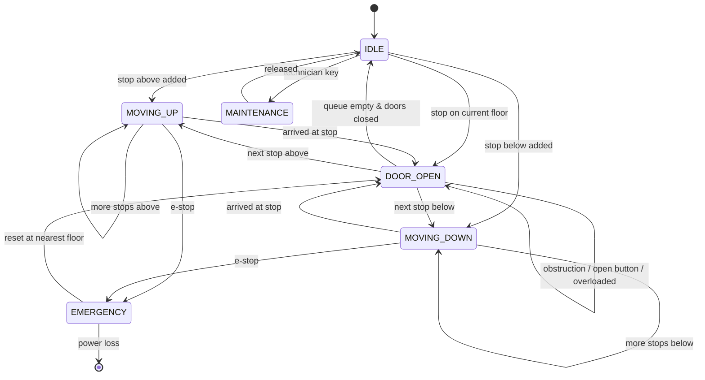
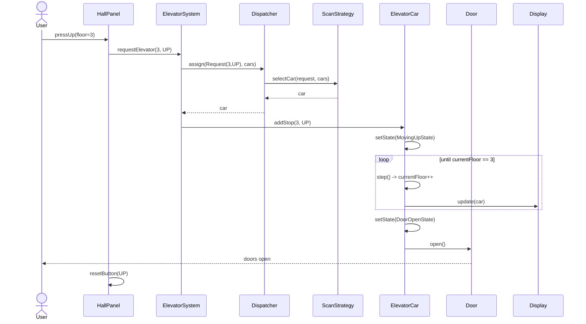
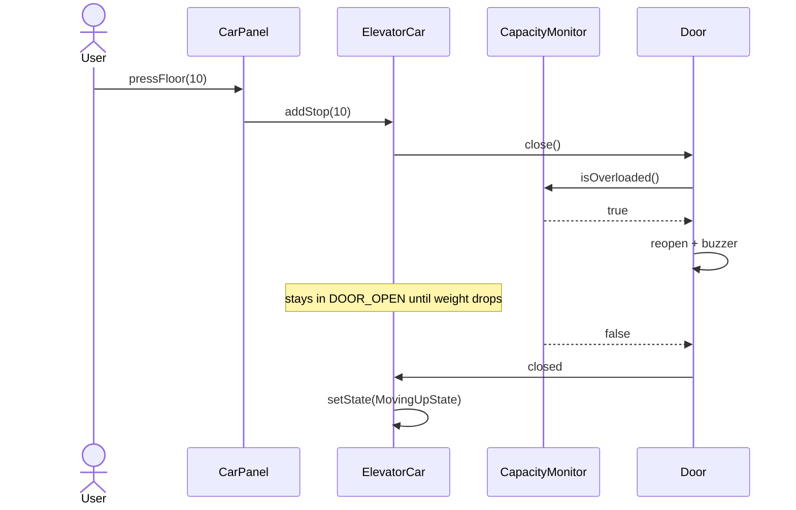

# Elevator System — Low Level Design (LLD)

A complete design document for the classic "Design an Elevator System" interview question. Covers requirement gathering, object modeling, UML, state machines, scheduling algorithms, design patterns, pseudocode, concurrency concerns, and follow-up questions.

---

## Table of Contents

1. [Problem Statement](#1-problem-statement)
2. [Requirement Gathering](#2-requirement-gathering)
3. [Core Concepts & Vocabulary](#3-core-concepts--vocabulary)
4. [Identifying Objects and Classes](#4-identifying-objects-and-classes)
5. [UML Class Diagram](#5-uml-class-diagram)
6. [State Machine](#6-state-machine)
7. [Sequence Diagrams](#7-sequence-diagrams)
8. [Design Patterns Used](#8-design-patterns-used)
9. [Scheduling Algorithms](#9-scheduling-algorithms)
10. [Pseudocode](#10-pseudocode)
11. [Concurrency & Thread Safety](#11-concurrency--thread-safety)
12. [Edge Cases](#12-edge-cases)
13. [Extensions & Scaling](#13-extensions--scaling)
14. [Interview Questions](#14-interview-questions)
15. [Common Mistakes](#15-common-mistakes)

---

## 1. Problem Statement

Design the low-level architecture for an elevator control system in a building with `F` floors and `E` elevator cars. Users request elevators from floor hall panels and select destination floors from inside the car. The system must dispatch cars efficiently, handle doors, respect capacity, and support maintenance and emergency modes.

---

## 2. Requirement Gathering

The first five minutes of the interview should be questions, not code. Below are the clarifying questions and the assumptions this design locks in.

### 2.1 Clarifying Questions to Ask

| Area | Question |
|---|---|
| Scale | How many floors? How many elevator cars? Basements? |
| Grouping | Is this a single car or a bank of cars under one controller? |
| Request types | External (hall) calls with direction, internal (car) calls with destination — both? |
| Destination dispatch | Do users enter their destination at the hall panel (modern systems) or just press up/down? |
| Capacity | Weight limit, passenger count limit, or both? |
| Priority | Express elevators? Freight? VIP/firefighter override? |
| Access control | Are some floors restricted (keycard, penthouse)? |
| Failure modes | What happens on power loss, stuck door, emergency stop? |
| Optimization goal | Minimize average wait time, worst-case wait, or energy use? |
| Display | Does the design need indicators, chimes, voice announcements? |

### 2.2 Functional Requirements (In Scope)

- **FR1** — A user can press an Up/Down button on any floor's hall panel.
- **FR2** — A user inside a car can select any permitted destination floor.
- **FR3** — The system dispatches the most suitable car to serve a hall request.
- **FR4** — A car moves between floors, stops at requested floors, and opens/closes doors.
- **FR5** — Doors stay open for a configurable dwell time; door-open and door-close buttons are supported.
- **FR6** — A car does not accept passengers beyond its weight/capacity limit.
- **FR7** — Each floor shows the position and direction of each car; each car shows its current floor.
- **FR8** — A car can be put into `MAINTENANCE` or `OUT_OF_SERVICE` mode and excluded from dispatch.
- **FR9** — An emergency stop halts the car; a fire-service mode recalls all cars to the ground floor.
- **FR10** — Requests are never permanently dropped (no starvation).

### 2.3 Non-Functional Requirements

- **NFR1 — Low latency**: dispatch decision in O(E log F) or better; real-time control loop.
- **NFR2 — Safety**: the system must never move with doors open, or exceed limits. Safety checks take precedence over optimization.
- **NFR3 — Fairness**: bounded worst-case wait; aging prevents starvation of unpopular floors.
- **NFR4 — Extensibility**: new dispatch strategies pluggable without modifying the car.
- **NFR5 — Availability**: failure of one car degrades throughput, not correctness.
- **NFR6 — Thread safety**: concurrent button presses from many floors must be safe.

### 2.4 Out of Scope

Physical motor control / PID, billing, building-wide IoT integration, persistence across power cycles, distributed multi-building deployment.

### 2.5 Back-of-the-Envelope

```
F = 50 floors, E = 6 cars
Travel time per floor      ~ 2s
Door open + dwell + close  ~ 8s
Avg trip (20 floors, 4 stops) = 20*2 + 4*8 = 72s
Throughput per car ≈ 50 passengers / 5 min during peak
```

---

## 3. Core Concepts & Vocabulary

| Term | Meaning |
|---|---|
| **Hall call / external request** | Button press on a floor; carries `(floor, direction)`. |
| **Car call / internal request** | Button press inside the car; carries `(destinationFloor)`. |
| **Dispatcher** | Component that assigns a hall call to a car. |
| **Dwell time** | How long doors remain open before auto-close. |
| **Up-peak / down-peak** | Traffic patterns (morning arrival, evening exit). |
| **SCAN / LOOK** | Disk-scheduling algorithms reused for elevator movement. |
| **Starvation** | A request that is never served because newer, closer requests keep arriving. |

---

## 4. Identifying Objects and Classes

### 4.1 Noun Extraction

From the requirements, the nouns are: *building, floor, elevator car, door, button, panel, display, request, direction, state, dispatcher, scheduler, passenger, capacity, sensor*.

### 4.2 Filtered Class List

| Class | Responsibility (single, clear) |
|---|---|
| `Building` | Aggregate root; owns floors and the elevator system. |
| `Floor` | Knows its number; owns a hall panel and a display. |
| `ElevatorSystem` | Facade; entry point for all requests; owns cars + dispatcher. |
| `ElevatorCar` | A single car: position, direction, state, door, pending stops. |
| `Door` | Open/close/obstruction state only. |
| `Button` (abstract) | Press behavior; `HallButton`, `CarButton`, `DoorButton`, `EmergencyButton`. |
| `Panel` (abstract) | Collection of buttons; `HallPanel`, `CarPanel`. |
| `Display` | Renders floor + direction (an `Observer`). |
| `Request` | Value object: `(floor, direction, type, timestamp)`. |
| `Dispatcher` | Chooses a car for a request using a `SchedulingStrategy`. |
| `SchedulingStrategy` (interface) | Pluggable algorithm: `ScanStrategy`, `NearestCarStrategy`, `LoadBalancedStrategy`. |
| `ElevatorState` (interface) | `IdleState`, `MovingUpState`, `MovingDownState`, `DoorOpenState`, `MaintenanceState`. |
| `CapacityMonitor` | Weight/passenger count checks. |
| `RequestQueue` | Per-car ordered stop set (two sorted sets: up-stops, down-stops). |

### 4.3 Enums

```java
enum Direction      { UP, DOWN, IDLE }
enum ElevatorStatus { IDLE, MOVING, DOOR_OPEN, MAINTENANCE, OUT_OF_SERVICE, EMERGENCY }
enum DoorStatus     { OPEN, CLOSED, OPENING, CLOSING, OBSTRUCTED }
enum RequestType    { HALL, CAR, EMERGENCY, MAINTENANCE }
```

### 4.4 Key Design Decisions

1. **Separate hall calls from car calls.** Hall calls belong to the *system* (any car can take them); car calls belong to a *specific car*. Conflating them is the most common design error.
2. **State pattern over `if/else` on status.** Behavior for "what happens when I press a button" differs per state; branching logic rots quickly.
3. **Strategy for dispatch.** Interviewers almost always ask "what if we change the algorithm?"
4. **Two sorted sets per car** (`upStops`, `downStops`) rather than a FIFO queue — a FIFO queue makes the elevator yo-yo and is a red flag.

---

## 5. UML Class Diagram

```mermaid
classDiagram
    class Building {
        -List~Floor~ floors
        -ElevatorSystem elevatorSystem
        +getFloor(int) Floor
    }

    class ElevatorSystem {
        -List~ElevatorCar~ cars
        -Dispatcher dispatcher
        -Queue~Request~ pendingHallCalls
        +requestElevator(floor, Direction) void
        +selectFloor(carId, floor) void
        +step() void
        +setMaintenance(carId, bool) void
        +fireServiceMode() void
    }

    class ElevatorCar {
        -int id
        -int currentFloor
        -Direction direction
        -ElevatorState state
        -Door door
        -RequestQueue stops
        -CapacityMonitor capacity
        -List~Display~ observers
        +addStop(int) void
        +step() void
        +openDoor() void
        +closeDoor() void
        +canServe(Request) bool
        +distanceTo(Request) int
        +setState(ElevatorState) void
        +notifyObservers() void
    }

    class RequestQueue {
        -TreeSet~int~ upStops
        -TreeSet~int~ downStops
        +add(int, Direction) void
        +nextStop(int, Direction) Integer
        +remove(int) void
        +isEmpty() bool
    }

    class Door {
        -DoorStatus status
        -int dwellMs
        +open() void
        +close() void
        +isObstructed() bool
    }

    class CapacityMonitor {
        -int maxWeightKg
        -int maxPassengers
        -int currentWeightKg
        +isOverloaded() bool
    }

    class Dispatcher {
        -SchedulingStrategy strategy
        +assign(Request, List~ElevatorCar~) ElevatorCar
        +setStrategy(SchedulingStrategy) void
    }

    class SchedulingStrategy {
        <<interface>>
        +selectCar(Request, List~ElevatorCar~) ElevatorCar
    }

    class ScanStrategy {
        +selectCar(Request, List~ElevatorCar~) ElevatorCar
    }
    class NearestCarStrategy {
        +selectCar(Request, List~ElevatorCar~) ElevatorCar
    }
    class LoadBalancedStrategy {
        +selectCar(Request, List~ElevatorCar~) ElevatorCar
    }

    class ElevatorState {
        <<interface>>
        +onRequest(ElevatorCar, Request) void
        +onStep(ElevatorCar) void
        +onDoorOpen(ElevatorCar) void
        +name() ElevatorStatus
    }

    class IdleState
    class MovingUpState
    class MovingDownState
    class DoorOpenState
    class MaintenanceState

    class Observer {
        <<interface>>
        +update(ElevatorCar) void
    }
    class Display {
        -int floorShown
        -Direction dirShown
        +update(ElevatorCar) void
    }

    class Button {
        <<abstract>>
        -bool pressed
        +press() void
        +reset() void
    }
    class HallButton
    class CarButton
    class EmergencyButton

    class Panel {
        <<abstract>>
        -List~Button~ buttons
    }
    class HallPanel
    class CarPanel

    class Request {
        -int floor
        -Direction direction
        -RequestType type
        -long timestamp
    }

    Building "1" *-- "many" Floor
    Building "1" *-- "1" ElevatorSystem
    ElevatorSystem "1" o-- "many" ElevatorCar
    ElevatorSystem "1" *-- "1" Dispatcher
    Dispatcher --> SchedulingStrategy
    SchedulingStrategy <|.. ScanStrategy
    SchedulingStrategy <|.. NearestCarStrategy
    SchedulingStrategy <|.. LoadBalancedStrategy
    ElevatorCar "1" *-- "1" Door
    ElevatorCar "1" *-- "1" RequestQueue
    ElevatorCar "1" *-- "1" CapacityMonitor
    ElevatorCar "1" *-- "1" CarPanel
    ElevatorCar --> ElevatorState
    ElevatorState <|.. IdleState
    ElevatorState <|.. MovingUpState
    ElevatorState <|.. MovingDownState
    ElevatorState <|.. DoorOpenState
    ElevatorState <|.. MaintenanceState
    ElevatorCar "1" o-- "many" Observer
    Observer <|.. Display
    Floor "1" *-- "1" HallPanel
    Floor "1" *-- "1" Display
    Panel <|-- HallPanel
    Panel <|-- CarPanel
    Panel "1" *-- "many" Button
    Button <|-- HallButton
    Button <|-- CarButton
    Button <|-- EmergencyButton
    Dispatcher ..> Request
```



### ASCII fallback (for whiteboard)

```
          +-----------+
          | Building  |
          +-----------+
           |         |
      1..* |         | 1
   +-------+     +----------------+
   | Floor |     | ElevatorSystem |<>----- Dispatcher ---> «SchedulingStrategy»
   +-------+     +----------------+                          ^  ^  ^
     |   |              | 1..*                             SCAN Nearest LoadBal
HallPanel Display       v
                  +--------------+        «ElevatorState»
                  | ElevatorCar  |------->  Idle/MovingUp/MovingDown/
                  +--------------+          DoorOpen/Maintenance
                   |    |      |  \
                Door  Queue  Capacity \--> Observers (Display)
                             CarPanel
```

---

## 6. State Machine



### State transition table

| Current | Event | Next | Action |
|---|---|---|---|
| IDLE | `addStop(f > cur)` | MOVING_UP | set `direction = UP` |
| IDLE | `addStop(f < cur)` | MOVING_DOWN | set `direction = DOWN` |
| IDLE | `addStop(f == cur)` | DOOR_OPEN | open doors |
| MOVING_UP | `step()`, floor is a stop | DOOR_OPEN | decelerate, open, clear stop |
| MOVING_UP | `step()`, not a stop | MOVING_UP | `currentFloor++` |
| DOOR_OPEN | `dwellExpired`, queue non-empty | MOVING_* | close, pick direction |
| DOOR_OPEN | `dwellExpired`, queue empty | IDLE | close, `direction = IDLE` |
| DOOR_OPEN | `obstruction` | DOOR_OPEN | re-open, restart dwell |
| any | `emergencyStop` | EMERGENCY | halt, alarm, unlock at nearest floor |
| any | `maintenanceOn` | MAINTENANCE | flush car calls, reject hall calls |

**Invariant to state out loud in an interview:** *the car never transitions into a MOVING state unless `door.status == CLOSED`.*

---

## 7. Sequence Diagrams

### 7.1 Hall call → dispatch → pickup



### 7.2 Car call with overload



---

## 8. Design Patterns Used

| Pattern | Where | Why / What it buys |
|---|---|---|
| **State** | `ElevatorState` hierarchy | Each status owns its own transition logic; no giant switch; adding `EMERGENCY` doesn't touch existing states. |
| **Strategy** | `SchedulingStrategy` | Swap SCAN ↔ nearest-car ↔ ML-based dispatch at runtime without touching `ElevatorCar`. Open/Closed Principle. |
| **Observer** | `Display`, logger, analytics subscribe to `ElevatorCar` | Decouples car movement from everything that wants to know about it. |
| **Singleton** | `ElevatorSystem` (per building) | One authoritative controller. *Caveat: say "I'd use dependency injection instead of a global singleton so it stays testable."* |
| **Factory Method** | `ButtonFactory`, `StateFactory` | Centralizes creation of button/state variants. |
| **Command** | `Request` as an executable command object | Enables queueing, logging, replay, and undo (cancel a call). |
| **Facade** | `ElevatorSystem` public API | Hall panels talk to one simple surface, not to cars and dispatchers directly. |
| **Mediator** | `Dispatcher` | Cars don't know about each other; the dispatcher coordinates them. |
| **Template Method** | `Panel.handlePress()` | Common press → validate → emit flow, with per-panel hooks. |
| **Chain of Responsibility** *(optional)* | Request filters: access control → capacity → maintenance → dispatch | Clean place to add rules. |

### SOLID applied

- **S** — `Door` only does doors; `CapacityMonitor` only does weight. The car orchestrates, it doesn't compute.
- **O** — New strategies and states are additions, not edits.
- **L** — Every `ElevatorState` honors the same contract; `MaintenanceState` rejects stops rather than throwing surprises.
- **I** — `Observer` exposes a single `update`; displays don't inherit dispatch methods.
- **D** — `Dispatcher` depends on the `SchedulingStrategy` abstraction, not on `ScanStrategy`.

---

## 9. Scheduling Algorithms

### 9.1 FCFS (First Come First Served)
Serve requests in arrival order. Simple, starvation-free, and **terrible** — the car reverses constantly. Mention it only to dismiss it.

### 9.2 SCAN (the "elevator algorithm")
Move in one direction to the topmost requested floor, serving everything en route, then reverse. Predictable, good throughput, bounded wait.

### 9.3 LOOK (recommended)
Like SCAN but reverses at the *last request* rather than the physical end of the shaft. Saves wasted travel. **This is what real elevators approximate.**

### 9.4 Cost-function dispatch (for a bank of cars)

Assign a hall call to the car minimizing a weighted cost:

```
cost(car, request) =
      w1 * distance(car.currentFloor, request.floor)
    + w2 * numberOfStopsEnRoute(car)
    + w3 * directionPenalty(car, request)     // huge if moving away
    + w4 * loadFactor(car)                    // discourage full cars
    - w5 * ageOf(request)                     // aging prevents starvation
```

Where `directionPenalty` is:

| Car direction | Request position & direction | Penalty |
|---|---|---|
| IDLE | anywhere | 0 |
| UP | above car, request UP | 0 (perfect en-route) |
| UP | above car, request DOWN | medium (must pass and return) |
| UP | below car | high (must finish upward sweep) |
| DOWN | below car, request DOWN | 0 |

### 9.5 Complexity

| Operation | Cost |
|---|---|
| `addStop` (TreeSet insert) | O(log F) |
| `nextStop` | O(log F) |
| `dispatch` across E cars | O(E log F) |
| `step` per tick | O(1) amortized |
| Memory | O(E · F) worst case |

### 9.6 Starvation prevention

Every `K` dispatch cycles, promote the oldest unserved hall call to highest priority regardless of cost. Or add the `- w5 * age` term above so cost monotonically decreases with wait time. **Always mention this** — it's the fairness question interviewers probe.

---

## 10. Pseudocode

### 10.1 Request queue (two sorted sets)

```text
class RequestQueue:
    upStops   = SortedSet<int>()    # ascending
    downStops = SortedSet<int>()    # ascending, traversed descending

    function add(floor, direction):
        if direction == UP:   upStops.insert(floor)
        else:                 downStops.insert(floor)

    # The core of LOOK: next target given where we are and where we're going
    function nextStop(currentFloor, direction):
        if direction == UP:
            candidate = upStops.ceiling(currentFloor)      # nearest >= current
            if candidate != null: return candidate
            # nothing above in UP set -> switch to serving DOWN calls from the top
            if not downStops.isEmpty(): return downStops.last()
            if not upStops.isEmpty():   return upStops.first()
            return null
        else if direction == DOWN:
            candidate = downStops.floor(currentFloor)      # nearest <= current
            if candidate != null: return candidate
            if not upStops.isEmpty():   return upStops.first()
            if not downStops.isEmpty(): return downStops.last()
            return null
        else:  # IDLE -> pick globally nearest
            return nearest(currentFloor, upStops ∪ downStops)

    function remove(floor):
        upStops.erase(floor); downStops.erase(floor)

    function isEmpty():
        return upStops.isEmpty() and downStops.isEmpty()
```

### 10.2 Elevator car — the control tick

```text
class ElevatorCar:
    id, currentFloor, direction, state, door, stops, capacity, observers

    function addStop(floor, direction = IDLE):
        if state.name() in {MAINTENANCE, OUT_OF_SERVICE, EMERGENCY}:
            reject("car unavailable"); return
        if not isValidFloor(floor): reject("bad floor"); return
        stops.add(floor, direction == IDLE ? inferDirection(floor) : direction)
        state.onRequest(this, Request(floor, direction))

    # Called every control tick (e.g. every 100ms, or per simulated step)
    function step():
        state.onStep(this)
        notifyObservers()

    function moveOneFloor():
        assert door.status == CLOSED          # SAFETY INVARIANT
        if direction == UP:   currentFloor += 1
        if direction == DOWN: currentFloor -= 1

    function arriveAndOpen():
        stops.remove(currentFloor)
        setState(DoorOpenState)
        door.open()
        ElevatorSystem.clearHallButton(currentFloor, direction)

    function distanceTo(request):
        return SchedulingStrategy.cost(this, request)
```

### 10.3 State implementations

```text
class IdleState implements ElevatorState:
    function onRequest(car, req):
        if req.floor == car.currentFloor:
            car.setState(DoorOpenState); car.door.open()
        else:
            car.direction = (req.floor > car.currentFloor) ? UP : DOWN
            car.setState(car.direction == UP ? MovingUpState : MovingDownState)

    function onStep(car): pass      # nothing to do while idle


class MovingUpState implements ElevatorState:
    function onStep(car):
        target = car.stops.nextStop(car.currentFloor, UP)
        if target == null:
            car.direction = IDLE; car.setState(IdleState); return
        if target == car.currentFloor:
            car.arriveAndOpen(); return
        if target < car.currentFloor:          # reversal point (LOOK)
            car.direction = DOWN; car.setState(MovingDownState); return
        car.moveOneFloor()
        if car.stops.contains(car.currentFloor):
            car.arriveAndOpen()

    function onRequest(car, req):
        car.stops.add(req.floor, req.direction)   # merged into current sweep


class DoorOpenState implements ElevatorState:
    function onStep(car):
        if car.door.isObstructed() or car.capacity.isOverloaded():
            car.door.restartDwell(); buzz(); return
        if car.door.dwellExpired():
            car.door.close()
            next = car.stops.nextStop(car.currentFloor, car.direction)
            if next == null:
                car.direction = IDLE; car.setState(IdleState)
            else if next > car.currentFloor:
                car.direction = UP;   car.setState(MovingUpState)
            else:
                car.direction = DOWN; car.setState(MovingDownState)

    function onRequest(car, req):
        car.stops.add(req.floor, req.direction)
        if req.floor == car.currentFloor: car.door.restartDwell()


class MaintenanceState implements ElevatorState:
    function onRequest(car, req): reject("in maintenance")
    function onStep(car):         pass
```

### 10.4 Dispatcher + strategies

```text
class Dispatcher:
    strategy

    function assign(request, cars):
        eligible = cars.filter(c -> c.isOperational() and not c.capacity.isFull())
        if eligible.isEmpty(): return null        # caller re-queues the request
        return strategy.selectCar(request, eligible)


class NearestCarStrategy implements SchedulingStrategy:
    function selectCar(request, cars):
        return argmin(cars, c -> abs(c.currentFloor - request.floor))


class ScanStrategy implements SchedulingStrategy:
    W_DIST = 1; W_STOPS = 2; W_DIR = 10; W_LOAD = 5; W_AGE = 3

    function selectCar(request, cars):
        best = null; bestCost = INFINITY
        for car in cars:
            cost = W_DIST  * abs(car.currentFloor - request.floor)
                 + W_STOPS * car.stops.size()
                 + W_DIR   * directionPenalty(car, request)
                 + W_LOAD  * car.capacity.loadFactor()
                 - W_AGE   * request.ageSeconds()
            if cost < bestCost: bestCost = cost; best = car
        return best

    function directionPenalty(car, req):
        if car.direction == IDLE: return 0
        movingToward = (car.direction == UP   and req.floor >= car.currentFloor)
                    or (car.direction == DOWN and req.floor <= car.currentFloor)
        if movingToward and car.direction == req.direction: return 0
        if movingToward: return 1
        return 2
```

### 10.5 System facade & control loop

```text
class ElevatorSystem:
    cars, dispatcher, pendingHallCalls (priority queue by age)
    lock = ReentrantLock()

    function requestElevator(floor, direction):      # external / hall call
        req = Request(floor, direction, HALL, now())
        synchronized(lock):
            car = dispatcher.assign(req, cars)
            if car == null: pendingHallCalls.push(req)
            else:           car.addStop(floor, direction)

    function selectFloor(carId, floor):              # internal / car call
        cars[carId].addStop(floor)

    function step():                                 # one control tick
        retryPendingCalls()
        for car in cars: car.step()

    function retryPendingCalls():
        for req in pendingHallCalls.drainOlderThan(THRESHOLD):
            car = dispatcher.assign(req, cars)
            if car != null: car.addStop(req.floor, req.direction)
            else:           pendingHallCalls.push(req)

    function fireServiceMode():
        for car in cars:
            car.stops.clear()
            car.addStop(GROUND_FLOOR)
            car.setDoorHoldOpenOnArrival(true)
```

---

## 11. Concurrency & Thread Safety

Real systems get simultaneous presses from dozens of panels.

| Concern | Approach |
|---|---|
| Two floors press at the same instant | Serialize dispatch behind a single lock (or a single-threaded dispatcher consuming a concurrent queue — preferred, lock-free for callers). |
| Per-car stop set mutated by dispatcher + control loop | Make `RequestQueue` thread-safe (`ConcurrentSkipListSet`) or confine all mutations to the car's own thread via a message queue. |
| Control loop vs. button thread | **Actor model**: each car is an actor with an inbox; buttons enqueue messages, the car processes them one at a time. No locks, no races. |
| Duplicate requests | Buttons are idempotent — pressing floor 5 twice adds one stop (set semantics). |
| Display updates | Push asynchronously; never block the control loop on an observer. |
| Deadlock | Lock ordering: system lock → car lock, never the reverse. Better: avoid nested locks by using the actor approach. |

```text
# Actor-style car loop
while running:
    msg = inbox.poll(timeout = TICK_MS)
    if msg != null: handle(msg)      # addStop, openDoor, emergency...
    step()                            # advance one floor / dwell
```

---

## 12. Edge Cases

- Request for the floor the car is already on → open doors, don't move.
- Request while doors are open on that same floor → extend dwell.
- All cars in maintenance → queue the call, show "service unavailable".
- Car overloaded → refuse to close; do not accept new car calls until resolved.
- Door obstructed repeatedly → after N retries, force close slowly or alarm.
- Invalid / restricted floor selection → reject at the `Button` level, not mid-flight.
- Emergency stop between floors → move to nearest floor at creep speed, then unlock.
- Power failure → battery lowers the car to the nearest floor and opens doors.
- Hall call cancellation (user walked away) → no reliable signal; rely on dwell timeout.
- Basement floors → use signed floor numbers or an index mapping (`-2, -1, 0, 1...`); don't assume floors start at 1.
- Two cars arriving at the same floor for the same call → dispatcher must mark the call as *assigned* atomically.

---

## 13. Extensions & Scaling

| Extension | Design change |
|---|---|
| **Destination dispatch** (enter destination in the lobby) | Hall panel sends `(origin, destination)`; dispatcher groups passengers with similar destinations into the same car. Reduces stops per trip dramatically. |
| **Express elevators** | Add `servedFloors: Set<int>` to `ElevatorCar`; `canServe()` filters on it. |
| **Zoning** (low-rise / high-rise banks) | `ZoneDispatcher` composed of per-zone `Dispatcher`s; a `CompositeStrategy`. |
| **Up-peak / down-peak modes** | Runtime `setStrategy(UpPeakStrategy)` — parked cars return to the lobby when idle. Strategy pattern pays off here. |
| **Predictive dispatch** | `MLStrategy implements SchedulingStrategy`, fed by historical traffic. Zero changes elsewhere. |
| **Multi-building / remote monitoring** | Cars publish state events; a central service aggregates. The `Observer` boundary becomes a network boundary. |
| **Persistence** | Event-source the `Request` commands; replay to rebuild state after restart. |
| **Energy optimization** | Add a `w6 * energyCost` term; park idle cars at statistically popular floors. |

---

## 14. Interview Questions

### 14.1 Requirement / clarification round

1. Single car or a bank? How many floors?
2. Does the hall panel capture direction only, or destination too?
3. What is the optimization target — average wait or worst-case wait?
4. Are there restricted floors or priority users?
5. What should happen when every car is out of service?

### 14.2 Design questions

6. **Why two sorted sets instead of one queue?** A FIFO queue forces the car to honor arrival order, causing reversals; sorted sets let the car sweep in one direction (LOOK) and serve everything en route.
7. **Where does the hall call live — in the system or in a car?** In the system until it's *assigned*; only then does it enter a car's stop set. Otherwise you can't reassign it when a closer car frees up.
8. **How do you prevent starvation?** Aging term in the cost function, or periodic priority promotion of the oldest pending call.
9. **Why State over a status enum with if/else?** Transition logic lives with the state; new modes (fire service, inspection) are new classes, not new branches in five methods.
10. **Where would you apply Strategy, and what changes if the algorithm changes?** Dispatch only. `ElevatorCar`, `Door`, `Display` are untouched.
11. **Is `ElevatorSystem` a Singleton?** Logically one per building — but inject it rather than using a static global, so tests can create isolated instances.
12. **How do you guarantee the car never moves with doors open?** An assertion/guard in `moveOneFloor()`, plus the state machine making `MOVING_*` reachable only from `DOOR_OPEN` after a successful `close()`.
13. **How do you decide direction when idle and two calls arrive equidistant above and below?** Tie-break by request age, then by load, then by a fixed preference (e.g. prefer UP in the morning) — and say that the tie-break must be deterministic for testability.
14. **How does the car know which hall button to clear on arrival?** It clears the button matching `(currentFloor, car.direction)` — not both directions, or you drop the opposite-direction call.

### 14.3 Deep-dive / follow-ups

15. Design for 100 floors and 20 cars — what changes? (Zoning, destination dispatch, O(E log F) dispatch still fine.)
16. How do you simulate and test this deterministically? (Inject a `Clock`; drive `step()` manually; property-test the invariants.)
17. What invariants would you assert in tests?
    - Doors closed whenever moving.
    - `currentFloor` changes by exactly ±1 per step.
    - Every added stop is eventually removed (liveness).
    - Never exceeds capacity.
18. How do you handle a car that stops reporting? (Heartbeat; mark `OUT_OF_SERVICE`; reassign its hall calls — note its *car* calls are lost, which is why hall/car separation matters.)
19. Make dispatch distributed across controllers — what breaks? (Double assignment; need consensus or a single leader dispatcher per bank.)
20. How would you A/B test two dispatch strategies in production?

### 14.4 Coding sub-problems often asked

- Implement `nextStop(currentFloor, direction)` for the LOOK algorithm.
- Implement the cost function and pick the best car.
- Implement the `DOOR_OPEN` dwell/obstruction logic.
- Simulate `N` steps and print the car's floor trace.

---

## 15. Common Mistakes

1. **One FIFO queue per car.** Produces a yo-yoing elevator. Use direction-aware sorted sets.
2. **Not separating hall calls from car calls.** Breaks reassignment and failover.
3. **A god `Elevator` class** that moves, dispatches, renders displays, and checks weight.
4. **Giant `switch (status)` blocks** instead of the State pattern.
5. **Forgetting the door safety invariant.** Interviewers wait for you to say it.
6. **Ignoring starvation.** Everyone optimizes wait time; few mention fairness.
7. **Hard-coding the strategy.** Then stumbling on "what if we change the algorithm?"
8. **Skipping requirement gathering** and coding for 10 minutes before asking how many cars there are.
9. **Assuming floors are `1..N`.** Basements exist.
10. **No concurrency story.** At least mention the lock or actor model.

---

## Quick Revision Sheet

```
CLASSES   Building · Floor · ElevatorSystem · ElevatorCar · Door · RequestQueue
          Dispatcher · SchedulingStrategy · ElevatorState · Display · Button · Request
ENUMS     Direction · ElevatorStatus · DoorStatus · RequestType
PATTERNS  State · Strategy · Observer · Singleton(DI) · Factory · Command
          Facade · Mediator · Template Method · Chain of Responsibility
ALGORITHM LOOK (direction-aware sweep) + cost-based dispatch with aging
INVARIANT never move with doors open; never exceed capacity; no starvation
COMPLEX   addStop O(log F) · dispatch O(E log F) · step O(1)
```