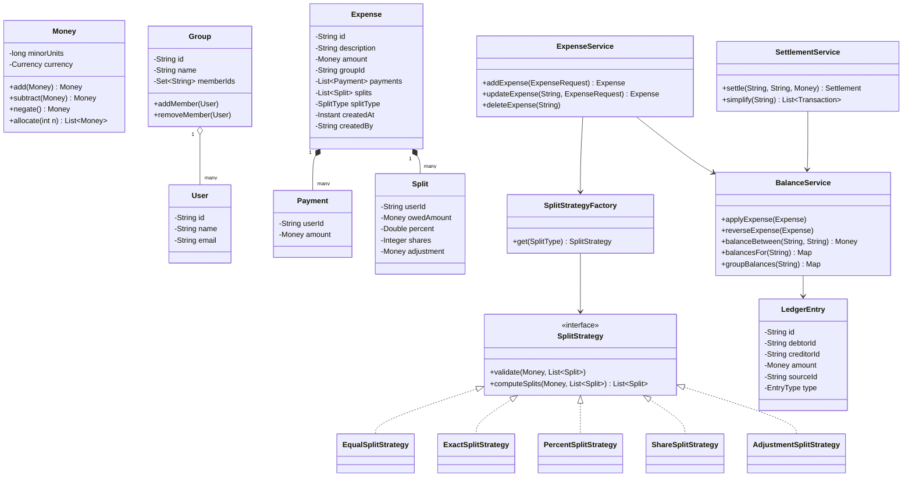

# Low Level Design — Splitwise

## 1. Requirements

### Functional
1. Register users; users can be part of multiple groups.
2. Create a group with a set of members (trips, flatmates, etc.).
3. Add an expense that can be:
   - paid by **one or many** users,
   - split among **any subset** of members.
4. Supported split types: `EQUAL`, `EXACT`, `PERCENT`, `SHARE`, `ADJUSTMENT`.
5. Show balances: per user, per group, and pairwise ("A owes B ₹250").
6. Settle up — record a payment that reduces a debt (full or partial).
7. Simplify debts inside a group so the number of transfers is minimal.
8. Edit / delete an expense and have balances stay correct.
9. Non-group (1-to-1) expenses.

### Non-functional
- **Extensibility**: adding a new split type must not touch existing code (Open–Closed).
- **Exactness**: money must never leak through rounding. `sum(splits) == expense amount` always.
- **Concurrency**: two expenses added to the same group simultaneously must not corrupt balances.
- **Auditability**: balances should be reconstructible from the expense history.

### Out of scope
Auth, payment-gateway integration, feed/notification delivery, OCR of receipts.

---

## 2. Design decisions worth stating up front

| Problem | Decision |
|---|---|
| Floating point money | `Money` value object storing **minor units** (paise/cents) as `long` + `Currency`. Never `double`, never `float`. |
| Rounding remainder on equal splits | Distribute the leftover minor units one-by-one to the first *k* participants (deterministically ordered), so the total reconciles exactly. |
| Split-type explosion | **Strategy** pattern + **Factory**, keyed by `SplitType`. |
| Balance storage | **Append-only ledger** of signed entries; a materialised `balances` table is a cache derived from it. Makes edit/delete a reversal entry instead of a destructive update. |
| Multiple payers | `Expense` holds `List<Payment>`, not a single `paidBy`. A single payer is just a list of size 1. |
| Multi-currency | FX rate is captured **at the time of the expense** and frozen on the expense row. Balances are stored per currency. |

---

## 3. Class model



---

## 4. Core code

### 4.1 Money

```java
public final class Money implements Comparable<Money> {

    private final long minorUnits;
    private final Currency currency;

    private Money(long minorUnits, Currency currency) {
        this.minorUnits = minorUnits;
        this.currency = Objects.requireNonNull(currency);
    }

    public static Money of(long minorUnits, Currency currency) {
        return new Money(minorUnits, currency);
    }

    public static Money zero(Currency currency) {
        return new Money(0L, currency);
    }

    public Money add(Money other) {
        assertSameCurrency(other);
        return new Money(Math.addExact(minorUnits, other.minorUnits), currency);
    }

    public Money subtract(Money other) {
        assertSameCurrency(other);
        return new Money(Math.subtractExact(minorUnits, other.minorUnits), currency);
    }

    public Money negate() {
        return new Money(-minorUnits, currency);
    }

    public boolean isZero()     { return minorUnits == 0; }
    public boolean isPositive() { return minorUnits > 0; }
    public long minorUnits()    { return minorUnits; }
    public Currency currency()  { return currency; }

    /**
     * Splits this amount into n parts that sum EXACTLY back to this amount.
     * The remainder minor units go to the first `remainder` parts.
     */
    public List<Money> allocate(int n) {
        if (n <= 0) throw new IllegalArgumentException("n must be > 0");
        long base = minorUnits / n;
        long remainder = Math.abs(minorUnits % n);
        long sign = minorUnits < 0 ? -1 : 1;

        List<Money> parts = new ArrayList<>(n);
        for (int i = 0; i < n; i++) {
            long part = base + (i < remainder ? sign : 0);
            parts.add(new Money(part, currency));
        }
        return parts;
    }

    /** Weighted allocation (used by PERCENT and SHARE strategies). */
    public List<Money> allocateByWeights(List<Long> weights) {
        long totalWeight = weights.stream().mapToLong(Long::longValue).sum();
        if (totalWeight <= 0) throw new IllegalArgumentException("weights must sum > 0");

        List<Money> parts = new ArrayList<>(weights.size());
        long assigned = 0;
        for (int i = 0; i < weights.size(); i++) {
            long part = (i == weights.size() - 1)
                    ? minorUnits - assigned                       // last absorbs rounding
                    : Math.floorDiv(minorUnits * weights.get(i), totalWeight);
            assigned += part;
            parts.add(new Money(part, currency));
        }
        return parts;
    }

    private void assertSameCurrency(Money other) {
        if (!currency.equals(other.currency)) {
            throw new CurrencyMismatchException(currency, other.currency);
        }
    }

    @Override public int compareTo(Money o) {
        assertSameCurrency(o);
        return Long.compare(minorUnits, o.minorUnits);
    }

    @Override public boolean equals(Object o) {
        if (!(o instanceof Money m)) return false;
        return minorUnits == m.minorUnits && currency.equals(m.currency);
    }

    @Override public int hashCode() { return Objects.hash(minorUnits, currency); }
}
```

### 4.2 Entities

```java
public enum SplitType { EQUAL, EXACT, PERCENT, SHARE, ADJUSTMENT }

public record Payment(String userId, Money amount) {}

public class Split {
    private final String userId;
    private Money owedAmount;       // computed output
    private Double percent;         // PERCENT input
    private Integer shares;         // SHARE input
    private Money adjustment;       // ADJUSTMENT input

    public Split(String userId) { this.userId = userId; }
    // getters / setters
}

public class Expense {
    private final String id;
    private String description;
    private final Money amount;
    private final String groupId;          // nullable for 1-1 expenses
    private final List<Payment> payments;
    private final List<Split> splits;
    private final SplitType splitType;
    private final String createdBy;
    private final Instant createdAt;
    private ExpenseStatus status;          // ACTIVE | DELETED

    // private constructor + static Builder
}
```

Builder is used here because an `Expense` has ~9 fields, several optional, and must be immutable once validated.

### 4.3 Split strategies

```java
public interface SplitStrategy {
    void validate(Money total, List<Split> splits);
    List<Split> computeSplits(Money total, List<Split> splits);
}
```

```java
public class EqualSplitStrategy implements SplitStrategy {

    @Override public void validate(Money total, List<Split> splits) {
        if (splits.isEmpty()) throw new InvalidSplitException("No participants");
    }

    @Override public List<Split> computeSplits(Money total, List<Split> splits) {
        List<Money> parts = total.allocate(splits.size());
        for (int i = 0; i < splits.size(); i++) {
            splits.get(i).setOwedAmount(parts.get(i));
        }
        return splits;
    }
}
```

```java
public class ExactSplitStrategy implements SplitStrategy {

    @Override public void validate(Money total, List<Split> splits) {
        Money sum = splits.stream()
                .map(Split::getOwedAmount)
                .reduce(Money.zero(total.currency()), Money::add);
        if (!sum.equals(total)) {
            throw new InvalidSplitException("Exact splits must sum to the total");
        }
    }

    @Override public List<Split> computeSplits(Money total, List<Split> splits) {
        return splits;   // user already supplied the amounts
    }
}
```

```java
public class PercentSplitStrategy implements SplitStrategy {

    private static final double EPSILON = 1e-6;

    @Override public void validate(Money total, List<Split> splits) {
        double sum = splits.stream().mapToDouble(Split::getPercent).sum();
        if (Math.abs(sum - 100.0) > EPSILON) {
            throw new InvalidSplitException("Percentages must sum to 100");
        }
    }

    @Override public List<Split> computeSplits(Money total, List<Split> splits) {
        // scale to basis points so weights stay integral
        List<Long> weights = splits.stream()
                .map(s -> Math.round(s.getPercent() * 100))
                .toList();
        List<Money> parts = total.allocateByWeights(weights);
        for (int i = 0; i < splits.size(); i++) {
            splits.get(i).setOwedAmount(parts.get(i));
        }
        return splits;
    }
}
```

`ShareSplitStrategy` is the same shape with `shares` as the weights.
`AdjustmentSplitStrategy` subtracts the sum of adjustments from the total, splits the remainder equally, then adds each user's adjustment back.

```java
public class SplitStrategyFactory {

    private final Map<SplitType, SplitStrategy> registry = new EnumMap<>(SplitType.class);

    public SplitStrategyFactory(List<SplitStrategy> strategies) { /* inject + register */ }

    public SplitStrategy get(SplitType type) {
        SplitStrategy strategy = registry.get(type);
        if (strategy == null) throw new UnsupportedSplitTypeException(type);
        return strategy;
    }
}
```

Adding `ITEMISED` later = one new class + one registry entry. No existing file changes.

### 4.4 Balance ledger

Pairwise balances are stored in a **canonical direction** so that `(A,B)` and `(B,A)` can never drift apart:

```java
record BalanceKey(String userA, String userB) {   // userA < userB lexicographically
    static BalanceKey of(String x, String y) {
        return x.compareTo(y) <= 0 ? new BalanceKey(x, y) : new BalanceKey(y, x);
    }
}
```

The stored value is "how much `userB` owes `userA`" — negative means the reverse.

```java
public class BalanceService {

    private final BalanceRepository balanceRepo;
    private final LedgerRepository ledgerRepo;

    @Transactional
    public void applyExpense(Expense expense) {
        for (LedgerEntry entry : toLedgerEntries(expense)) {
            ledgerRepo.save(entry);
            applyEntry(entry);
        }
    }

    @Transactional
    public void reverseExpense(Expense expense) {
        for (LedgerEntry entry : toLedgerEntries(expense)) {
            LedgerEntry reversal = entry.reversed();   // amount negated
            ledgerRepo.save(reversal);
            applyEntry(reversal);
        }
    }

    /**
     * Net each participant: (what they owe) - (what they paid).
     * Positive  => debtor. Negative => creditor.
     * Then match debtors to creditors greedily to produce the minimum
     * number of pairwise edges for this one expense.
     */
    private List<LedgerEntry> toLedgerEntries(Expense expense) {
        Currency ccy = expense.getAmount().currency();
        Map<String, Money> net = new LinkedHashMap<>();

        for (Split s : expense.getSplits()) {
            net.merge(s.getUserId(), s.getOwedAmount(), Money::add);
        }
        for (Payment p : expense.getPayments()) {
            net.merge(p.userId(), p.amount().negate(), Money::add);
        }

        Deque<Map.Entry<String, Money>> debtors = new ArrayDeque<>();
        Deque<Map.Entry<String, Money>> creditors = new ArrayDeque<>();
        net.forEach((userId, amt) -> {
            if (amt.isZero()) return;
            Map.Entry<String, Money> e = Map.entry(userId, amt);
            (amt.isPositive() ? debtors : creditors).add(e);
        });

        List<LedgerEntry> entries = new ArrayList<>();
        // ... greedy pair-off, emitting LedgerEntry(debtor, creditor, min(|d|,|c|))
        return entries;
    }

    private void applyEntry(LedgerEntry e) {
        BalanceKey key = BalanceKey.of(e.debtorId(), e.creditorId());
        boolean flipped = !key.userA().equals(e.creditorId());
        Money delta = flipped ? e.amount().negate() : e.amount();
        balanceRepo.increment(key, e.amount().currency(), delta);   // atomic UPDATE ... SET v = v + ?
    }

    public Money balanceBetween(String a, String b, Currency ccy) { /* ... */ }

    public Map<String, Money> balancesFor(String userId, Currency ccy) { /* ... */ }
}
```

**Why a ledger and not just a balances table?** Edit and delete become trivially correct — you post a reversal and re-apply, never recompute from scratch, and you keep a full audit trail. Validation job: `sum(ledger per pair) == balances row`.

### 4.5 Expense service (orchestration)

```java
public class ExpenseService {

    private final SplitStrategyFactory strategyFactory;
    private final BalanceService balanceService;
    private final ExpenseRepository expenseRepo;
    private final GroupRepository groupRepo;
    private final List<ExpenseObserver> observers;

    @Transactional
    public Expense addExpense(ExpenseRequest request) {
        validateMembership(request);
        validatePaymentsMatchTotal(request);

        SplitStrategy strategy = strategyFactory.get(request.splitType());
        List<Split> splits = request.splits();
        strategy.validate(request.amount(), splits);
        splits = strategy.computeSplits(request.amount(), splits);

        assertSumsToTotal(request.amount(), splits);   // defence in depth

        Expense expense = Expense.builder()
                .id(IdGenerator.next())
                .description(request.description())
                .amount(request.amount())
                .groupId(request.groupId())
                .payments(request.payments())
                .splits(splits)
                .splitType(request.splitType())
                .createdBy(request.actorId())
                .build();

        expenseRepo.save(expense);
        balanceService.applyExpense(expense);
        observers.forEach(o -> o.onExpenseAdded(expense));
        return expense;
    }

    @Transactional
    public Expense updateExpense(String expenseId, ExpenseRequest request) {
        Expense old = expenseRepo.findActive(expenseId);
        balanceService.reverseExpense(old);
        expenseRepo.markDeleted(old);
        return addExpense(request);
    }

    private void validatePaymentsMatchTotal(ExpenseRequest r) {
        Money paid = r.payments().stream()
                .map(Payment::amount)
                .reduce(Money.zero(r.amount().currency()), Money::add);
        if (!paid.equals(r.amount())) {
            throw new InvalidExpenseException("Payments must sum to the expense amount");
        }
    }
}
```

`ExpenseObserver` is the **Observer** hook for notifications, activity feed, and analytics — so none of that logic lives inside `ExpenseService`.

### 4.6 Settlement and debt simplification

```java
public record Transaction(String fromUserId, String toUserId, Money amount) {}

public class SettlementService {

    private final BalanceService balanceService;
    private final GroupRepository groupRepo;

    @Transactional
    public Settlement settle(String fromUserId, String toUserId, Money amount) {
        Money owed = balanceService.balanceBetween(fromUserId, toUserId, amount.currency());
        if (amount.compareTo(owed) > 0) {
            throw new InvalidSettlementException("Cannot settle more than owed");
        }
        LedgerEntry entry = LedgerEntry.settlement(fromUserId, toUserId, amount);
        return balanceService.applySettlement(entry);
    }

    /**
     * Minimise the number of transfers needed to clear a group.
     * Net every member, then repeatedly match the largest debtor
     * with the largest creditor. Produces at most n-1 transfers.
     */
    public List<Transaction> simplify(String groupId, Currency ccy) {
        Map<String, Money> net = balanceService.groupBalances(groupId, ccy);

        Comparator<Map.Entry<String, Money>> byAmountDesc =
                Map.Entry.<String, Money>comparingByValue().reversed();

        PriorityQueue<Map.Entry<String, Money>> creditors = new PriorityQueue<>(byAmountDesc);
        PriorityQueue<Map.Entry<String, Money>> debtors   = new PriorityQueue<>(byAmountDesc);

        net.forEach((userId, amount) -> {
            if (amount.isZero()) return;
            if (amount.isPositive()) creditors.add(Map.entry(userId, amount));
            else debtors.add(Map.entry(userId, amount.negate()));
        });

        List<Transaction> result = new ArrayList<>();
        while (!creditors.isEmpty() && !debtors.isEmpty()) {
            var creditor = creditors.poll();
            var debtor   = debtors.poll();

            Money transfer = creditor.getValue().compareTo(debtor.getValue()) <= 0
                    ? creditor.getValue() : debtor.getValue();

            result.add(new Transaction(debtor.getKey(), creditor.getKey(), transfer));

            Money creditorLeft = creditor.getValue().subtract(transfer);
            Money debtorLeft   = debtor.getValue().subtract(transfer);
            if (!creditorLeft.isZero()) creditors.add(Map.entry(creditor.getKey(), creditorLeft));
            if (!debtorLeft.isZero())   debtors.add(Map.entry(debtor.getKey(), debtorLeft));
        }
        return result;
    }
}
```

Complexity: `O(n log n)` for *n* group members. Note the honest caveat for an interview — finding the true minimum number of transactions is NP-hard in the general case; this greedy approach guarantees at most `n-1` transfers, which is what Splitwise itself effectively does.

Also worth flagging: simplification is a **presentation/settlement suggestion**, not a mutation. Don't overwrite the ledger with simplified edges unless the user explicitly opts in, because it destroys the "who actually owes whom" provenance.

---

## 5. Persistence schema

```
users(id PK, name, email UNIQUE, phone, created_at)

groups(id PK, name, created_by FK, default_currency, created_at)

group_members(group_id FK, user_id FK, joined_at, PRIMARY KEY(group_id, user_id))

expenses(id PK, group_id FK NULL, description, amount_minor, currency,
         split_type, created_by FK, created_at, status,
         fx_rate NULL, superseded_by FK NULL)

expense_payers(expense_id FK, user_id FK, amount_minor,
               PRIMARY KEY(expense_id, user_id))

expense_splits(expense_id FK, user_id FK, owed_minor,
               percent NULL, shares NULL, adjustment_minor NULL,
               PRIMARY KEY(expense_id, user_id))

ledger_entries(id PK, debtor_id FK, creditor_id FK, amount_minor, currency,
               source_type, source_id, created_at)
    INDEX (debtor_id, creditor_id, currency)

balances(user_a FK, user_b FK, currency, amount_minor, version,
         PRIMARY KEY(user_a, user_b, currency))   -- user_a < user_b

settlements(id PK, from_user FK, to_user FK, amount_minor, currency,
            method, created_at)
```

`balances` is denormalised for read speed; `ledger_entries` is the source of truth.

---

## 6. Concurrency

- All writes in `addExpense` sit in one transaction: expense rows + ledger entries + balance increments commit or roll back together.
- Balance updates use an atomic `UPDATE balances SET amount_minor = amount_minor + ? WHERE ...` rather than read-modify-write, so two concurrent expenses on the same pair are serialised by the row lock.
- Deadlock avoidance: because `BalanceKey` is canonically ordered, pairs are always locked in a consistent order.
- The `version` column supports optimistic locking if you need read-modify-write for a repair job.

---

## 7. API surface

```
POST   /v1/users
POST   /v1/groups                       { name, memberIds }
POST   /v1/groups/{id}/members
POST   /v1/expenses                     { groupId?, amount, currency, splitType,
                                          payments[], splits[] }
PATCH  /v1/expenses/{id}
DELETE /v1/expenses/{id}
GET    /v1/users/{id}/balances           -> per-counterparty net
GET    /v1/groups/{id}/balances
GET    /v1/groups/{id}/simplify          -> List<Transaction>
POST   /v1/settlements                   { fromUserId, toUserId, amount, currency }
GET    /v1/groups/{id}/expenses?cursor=  -> paginated feed
```

Add an `Idempotency-Key` header on `POST /expenses` and `POST /settlements` — mobile retries are the main source of duplicate expenses in a real system.

---

## 8. Edge cases to call out

| Case | Handling |
|---|---|
| Payer is also a participant | Falls out naturally from the net-then-pair logic; no special case. |
| Payer is NOT a participant | Allowed — they are pure creditor. |
| `₹100 / 3` | `allocate(3)` → `3334, 3333, 3333` paise. Sums exactly. |
| Percent splits with repeating decimals | Last participant absorbs the rounding residue in `allocateByWeights`. |
| Removing a member with non-zero balance | Reject; require settle-up first. |
| Deleting a settled expense | Reversal entry; balance may go negative, which is valid (now a credit). |
| Cross-currency group | Balances keyed by currency; never auto-net across currencies. |
| Self-expense (only payer is participant) | Net is zero → zero ledger entries written. |
| Circular debt A→B→C→A | `simplify` collapses it to zero transfers. |

---

## 9. Patterns used, and why

- **Strategy** — `SplitStrategy`. The one part of the system guaranteed to grow.
- **Factory** — `SplitStrategyFactory`. Keeps `switch` on `SplitType` out of the service layer.
- **Builder** — `Expense`. Many fields, several optional, immutable result.
- **Observer** — `ExpenseObserver`. Notifications and feed decoupled from the write path.
- **Value Object** — `Money`, `BalanceKey`. Equality by value, no identity, immutable.
- **Repository** — storage abstracted behind interfaces so the core logic is testable in memory.

Patterns deliberately *not* used: no Singleton (dependency injection handles lifecycle), no Command/undo stack (the ledger already gives reversibility).